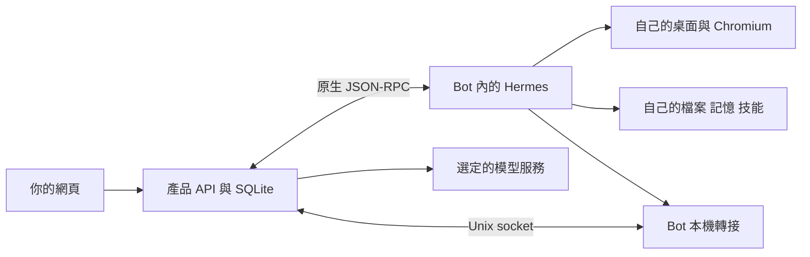

# LazyBoy

從網頁交辦工作給常駐 Bot，執行核心是 Hermes Agent。每個命名 Bot 有自己的持久 Linux 桌面、Chromium、檔案、登入、對話上下文、記憶與技能。從網頁聊天、交辦、補充、停止，或開啟電腦直接接手；不需要 Telegram。

專案位於 `/home/daniel/Projects/LazyBoyHermes`，與原本的 LazyBoy2 分開。原專案的聊天、登入與資料沒有搬入。

## 啟動

這臺主機已安裝依賴、建置前端及 Docker 映像。

若要關閉舊版 LazyBoy2 的 API、開發前端、電腦及分類器／閘道，再載入新版 Hermes，請在可存取主機 Docker 的終端執行：

```bash
python3 scripts/switch-to-hermes.py
```

切換指令先檢查權限並建置，成功後才停止舊服務；保留資料和舊版 Docker volumes，更新 Hermes 電腦映像，重開原先運行中的 Hermes 電腦，並檢查新版分流 API。若原有分類器在運行，也會啟動新版分類器並等待暖機。切換時明確使用 `0.0.0.0`，並核對新版服務 PID 持有的監聽 socket；舊版 8787／5173 未關閉時不會宣稱切換完成。`--check` 只列出切換範圍，不啟停服務。

若新版已運行，只需要停止舊版的全部程序與容器：

```bash
python3 scripts/switch-to-hermes.py --stop-old
```

此模式保留正在運行的新版，不重建映像。程序掃描支援重建後標成 `(deleted)` 的舊執行檔；先給予正常停止的時間，逾時才終止已確認身分的程序及子程序。

單獨啟動 Hermes 服務：

```bash
cd /home/daniel/Projects/LazyBoyHermes
make start
```

打開 **http://localhost:8790**。停止產品服務：

```bash
make stop
```

執行 `make` 或 `make help` 可查看指令。也可以執行 `./scripts/start.sh` 在終端前景運行。關閉網頁不會停止正在工作的 Bot；停止產品服務會中斷工作，保留檔案與對話，重啟後不會重放結果未知的操作。Bot 電腦容器會保留，重新交辦時會連回。

## 第一次安裝到別臺 Linux 主機

需要 Docker、Node/npm 和 uv。使用固定的 Hermes 原始碼及依賴鎖檔：

```bash
./scripts/bootstrap.sh
./scripts/start.sh
```

第一次在網頁「設定 → 模型」只要做三件事：選供應商（OpenRouter、Anthropic、OpenAI、DeepSeek、Gemini、OpenCode 等 40 餘個 Hermes 內建供應商）、貼上 API key、選模型。服務網址會自動帶入，離開金鑰欄位時自動載入模型清單。選定模型後產品會用三種 API 介面（Chat Completions、Responses、Anthropic Messages）各送一個極小的請求，自動找出模型實際可用的介面並顯示「✓ 可以使用」或無法使用的原因（金鑰錯誤、模型下架、供應商忙碌）；無法使用的模型排在清單最後。打開設定頁時，全域與各 Bot 正在用、還沒檢查過的模型也會自動檢查並修正。清單外的服務選「自訂 OpenAI 相容服務…」並填寫基底網址（通常以 `/v1` 結尾）。供應商金鑰保留在產品服務端；Bot 只有自己的連線憑證。

內建清單存在 `server/hermes_providers.json`，由 Bot 映像裡的 Hermes 匯出；升級 Hermes 並重建映像後執行 `make providers` 更新。

API 介面、推理強度、讀取圖片、產生圖片與服務網址收在「進階設定」，通常不用改：讀取圖片依 Hermes 對該模型的能力資料自動開啟，推理強度只列出模型支援的等級，未指定時使用 medium。模型設定的變更在下一次工作生效。交辦因模型問題失敗時，對話會先用中文說明原因與該怎麼做，原始錯誤附在下方。

安裝前可執行 `./scripts/bootstrap.sh --check-only` 檢查 Git、uv、Node 20 以上、npm、Docker daemon 與 Compose。安裝後執行 `python3 scripts/doctor.py --ready` 核對版本及安裝產物；`--static` 只檢查檔案與工具版本。

「設定 → 模型 → 對話與工作分流」可選聊天、工作與備援模型，以及各自的推理強度、等待上限。工具工作開始後會升級到工作模型；限流或連線失敗時依序備援，開始串流後不重播。Bot 自己指定的模型優先。單組分流模型使用相同 API 介面，不同 Bot 可使用不同介面。

Semantic Router／Laya 使用可選的本機服務：`./scripts/routing.sh start`，預設 port 為 `8778`。服務會下載及暖機模型；就緒後可在分流進階設定啟用。預設只記錄分類，取消此選項後才採用高信心分類；不確定或不可用時交給工作模型。也可用 `./scripts/bootstrap.sh --with-routing` 一起安裝。`./scripts/routing.sh stop` 只停止此專案的分類器。

這臺主機已匯入原 LazyBoy 的供應商設定。另一次手動匯入只會移轉模型設定：

```bash
uv run python scripts/import-settings.py /path/to/providers.json
```

已有設定時不會覆蓋；明確要替換時加 `--force`。

## 使用方式

- 左側建立或選擇 Bot，設定名字、人設、外觀與模型。未指定模型時使用全域預設值。
- 在對話中交辦工作。工作中傳送補充會送進當前 Hermes；每個 Bot 同時只執行一個任務。
- 同一個 Bot 可以開多個對話串，類似 Hermes 在 Telegram 的 threads：聊天標題旁的「新對話」建立新串，上方分頁切換。每串對應自己的原生 Hermes session，有獨立上下文與標題（Hermes 會自動命名，也可以手動改名）；記憶、技能、檔案與電腦則共用。一臺電腦一次只做一件事，其他對話串的訊息會排隊，並顯示 Bot 正在哪一串工作。
- 回覆以聊天適用的 Markdown 呈現：標題、清單、勾選清單、表格、引用、程式碼區塊（語法上色、可複製），保留單一換行，中文旁的粗體也能正確顯示。

### 日常操作

- **側欄**：在 Bot 上按右鍵（手機長按）開選單，可以「釘選到最上面」、「從側欄隱藏」（收進最下面的「已隱藏」）、「標為未讀」、「複製 Bot」、「關閉通知」。「複製 Bot」產生「某某 副本」，帶外觀、人設、模型、技能、專用串接與定時任務（定時任務先暫停，避免同一件事跑兩次），不帶對話、記憶與檔案。桌機可以把 Bot 拖到別的分區、「已釘選」或「已隱藏」，分區名稱也能拖曳排序。有新動靜而你還沒看的 Bot 或群組有藍點；未讀與等你回覆的數量也會顯示在分頁標題和安裝後的 App 圖示上。
- **新增**：側欄的「＋」（Ctrl+Alt+N）打開「新增」：輸入名字直接建立 Bot、從「認識你未來的隊友」範本開始（幕僚長、選品研究員、社群小編、業務開發等），或勾選 2 到 6 個 Bot 開群組對話。
- **搜尋與指令**：Ctrl+K（Mac 為 ⌘K）打開搜尋面板，可以找 Bot、群組、所有對話裡的訊息、檔案與定時任務，選訊息會跳到原本的位置並閃一下；不輸入時列出最近的對話與常用動作（新增、連接應用程式、設定、切換外觀…）。Ctrl+F 在目前對話裡尋找並標示所有結果，Enter／Shift+Enter 切換。
- **鍵盤快速鍵**：Ctrl+/ 列出全部，包含 Ctrl+I 回到輸入框、Ctrl+D 語音輸入、Ctrl+B 精簡側欄（只顯示頭像）、Alt+↑／↓ 切換上一個／下一個 Bot、Alt+1～9 跳到側欄第幾個、Ctrl+, 設定、Ctrl+Shift+, 目前 Bot 的設定。
- **輸入框**：打 `/` 選技能（寫成「使用「技能名」技能」），打 `@` 提到其他 Bot、群組或已連接的應用程式；麥克風按鈕（或 Ctrl+D）用瀏覽器的語音辨識把說的話打進輸入框，送出前可以修改。
- **語音**：輸入框是空的時候，右下的耳機按鈕開始「語音對話」：說完停一下就送出，Bot 回答後自動唸出來，再繼續聽，直到按「結束語音對話」。每則回答旁也有「朗讀」。都使用瀏覽器內建的語音辨識與合成（Chrome、Edge、Safari）。
- **分享登入**：在 Bot 上按右鍵「分享登入給其他 Bot」，勾選網站（例如 shopee.tw）和要分享的 Bot，對方的瀏覽器就有同樣的登入，不用再登入一次。只複製勾選的網站，登入資料直接在兩台電腦之間傳送、不會出現在畫面上。
- **從其他 App 分享**：在 Android 裝成 App 之後，其他 App 的「分享」選單會出現 LazyBoy；選一個 Bot 或群組，分享的文字和連結就放進那個輸入框，可以再補充後送出。（iPhone 的網頁 App 不支援分享選單。）
- **範本**：在 Bot 上按右鍵「存成範本」，之後在「新增 → 你的範本」（或側欄的「Bot 範本」）一鍵建立同樣設定的 Bot（人設、外觀、技能與串接設定，不含對話、記憶與登入）。分享與範本只帶這個 Bot 自己的技能，Hermes 內建、沒改過的技能不會重複打包。
- **先問我**：Bot 設定的「這些事先問我」可以勾選寄出或傳送訊息、公開發佈、付款購買、刪除資料；勾選的動作 Bot 會先說明並等你同意（定時任務或隊友交辦時 10 分鐘沒回覆就不做）。預設都不勾。
- **主要 Bot**：在 Bot 上按右鍵「設為主要 Bot」，側欄名字旁出現星號。一次只有一個；其他 Bot 需要協調、彙整或不確定找誰時會交給它，打開 LazyBoy 時也先開它。
- **通知**：「設定 → 一般 → 通知」打開後，LazyBoy 在背景時，Bot 完成或等你回覆會跳系統通知，點一下回到那個 Bot；你在 App 裡看別的 Bot 時改為畫面上的提示。
- **回覆與表情**：每則回答旁有「回覆這則訊息」（輸入框上方會出現要回覆的內容，送出時一起引用）、「表情回應」（👍 ❤️ 😂 🎉 🙏 👀，只是輕量的回應，Bot 不會因此動作）與「複製」；在桌機選取一段文字會出現「引用」。沒送出的草稿（包含群組對話）在切換對話與重新整理後保留（關掉分頁就清除，不長期存在裝置上）。
- **Context 用量**：對話右上「⋯ → Context 用量」顯示這段對話佔了模型 context 的多少，分成人設與系統說明、內建工具、應用程式工具、技能清單、記憶、對話紀錄；可以「壓縮舊對話」（保留最近的內容，較早的濃縮成摘要）或開新對話。用到一半左右時 Hermes 也會自動壓縮。
- **模型用量**：「設定 → 模型用量」依供應商與模型統計 token、請求次數、快取命中率與每日用量（7／30／90 天），包含背景小分隊、對話壓縮與自動命名的請求。
- **外觀**：「設定 → 一般 → 外觀」可選淺色／深色／跟隨系統，強調色預設是 Grok 風格的黑白，也可以改回紫色。系統設定「減少動態效果」時不播放進場動畫。
- **記憶**：Bot 設定的「記憶」分頁列出「關於你」與「Bot 記住的事」，可以修改、刪除、新增，並顯示 Hermes 的字數上限；修改從下一次對話生效。
- **Bot 用量**：Bot 設定的儲存空間區塊上方顯示最近 7 天的工作次數與 token 數，用到多個模型時列出各自用量。
- **審批**：Hermes 允許時，審批卡片多一個「一律允許」，同樣的操作以後不再詢問。

### 團隊：Bot 互相傳訊息與群組對話

照 Grok Bot 的做法，Bot 之間像團隊一樣分工：

- **互傳訊息（非同步）**：Bot 需要隊友的專長時，用 `message_bot` 工具傳訊息給對方（`request` 請求、`question` 提問、`fyi` 通知）。對方在自己的對話裡被叫醒處理，最後的回答會自動送回原本的對話，發起的 Bot 再整合回報你；中間不會卡住等待，也不需要反覆查詢。你也可以直接交代「去問某某」。
- **對話裡的事件列**：發起方顯示「已傳請求給 [頭像] 某某」，收件方顯示「來自 [頭像] 某某的請求／回覆」。點開看內容，「查看與某某的所有往來」列出兩個 Bot 之間的完整訊息。Bot 正在處理隊友的請求時，工作卡片顯示「正在處理某某的請求」。
- **隊友名單**：每個 Bot 的人設會附上其他 Bot 的名字、職稱與介紹，作為分工參考（不是指令）。介紹寫在 Bot 設定的「人設」。
- **群組對話**：側欄「＋ → 新增群組對話」選 2 到 6 個 Bot。用 `@名字` 指定這一步誰負責；沒有點名時，每個成員自己判斷要不要回答，不需要時保持沉默；`@everyone` 點名所有人。Bot 在回答裡 @ 另一位成員就是把下一步交給他。訊息上的「回覆」會預填 @ 對方。群組在每個成員那邊用隱藏的對話串進行，不會混進它和你的私人對話。
- **群組附件**：群組輸入框可以加入檔案（迴紋針、拖曳或貼上），檔案會放到每位成員電腦的同一個位置，接手的 Bot 都打得開；圖片也會附給看得懂圖的模型。
- **群組不顯示的東西**：審批、登入、補資料等提問出現在那個 Bot 自己的對話裡，群組只會顯示「某某在自己的對話等你回覆」。
- **防止失控**：你的訊息永遠排在 Bot 傳來的訊息前面；同一串 Bot 往來最多 6 次，之後要先回報你；群組中一則訊息之後最多 4 輪 Bot 互相點名；回覆與通知不會再要求回覆；Bot 不該回「收到」「謝謝」這類空訊息。停止一個 Bot 會一併停止它交給其他 Bot 的工作。
- **費用**：每一次 Bot 回覆都會用到模型，包含 Bot 之間的訊息與群組回覆。成員越少、點名越明確，花費越少。
- **Bot 自己開群組、建立 Bot**：Bot 可以用 `start_group_chat` 找隊友開群組並在開場訊息點名第一棒，用 `post_to_group` 在所屬群組發言；缺少某種專長且你同意時，用 `create_bot` 建立新的 helper Bot（每個 Bot 一天最多 3 個、總數上限 50），用 `update_my_profile` 改自己的職稱或頭像。這些動作在 Bot 的對話裡都有事件列可以點開。
- **合併顯示與未讀**：連續多則 Bot 往來合併成「與某某的 N 則訊息」；側欄有新動靜而你還沒看的 Bot 或群組會出現藍點。
- **無人看管的提問會過期**：不是你發起的工作（隊友的訊息、定時任務、群組裡 Bot 互相點名）提出的審批或問題，10 分鐘內沒回覆就自動拒絕並通知 Bot 改為回報狀況；卡片上會顯示剩餘時間。
- Bot 的協作工具會在每次開工前從專案放進它的 `/hermes`，更新不需要重建電腦映像。
- 點「電腦」看它使用的桌面。你和 Bot 操作同一個瀏覽器；需要登入時直接在這個面板登入。不同 Bot 的登入彼此分開。
- Hermes 提問時在卡片回答，支援多題、複選、允許操作與秘密輸入。秘密答案不會寫進產品對話或事件紀錄。
- 工作中只顯示一行「思考中」與目前步驟；完成後過程收在答案上方的「已完成 · N 個步驟」，點開才看細節。
- 工作產出的檔案放在 `/workspace`。答案下方只列最重要的 3 個檔案；檔案面板預設隱藏建置輸出、快取與 log，按「顯示全部」可查看。上傳的檔案也進入該 Bot 的工作目錄。
- 寫程式、建專案、修 bug 時，Bot 會用內建的 `grok-build` 技能交給 Grok Build CLI（`grok`），自己驗收並回報摘要。第一次使用前，在該 Bot 的「電腦 → 終端機」執行 `grok login`。
- 需要深入研究或比較多個來源時，Bot 用內建的 `deep-research` 技能：先列計畫，用子 agent 平行查證，交叉比對後把附來源的報告寫進 `/workspace/reports/`。
- 工作中會顯示 Bot 自己列的計畫；完成後「已思考 · N 個步驟」可展開看計畫與每一步（失敗的步驟標紅），用到網路資料時答案下方有「來源」清單。重新整理頁面後仍保留。
- 網路搜尋預設使用 Exa 免費額度；「設定 → 模型 → 網路搜尋」可改用 Tavily、Brave 或 DuckDuckGo 並填 API key。填入 xAI API key 後 Bot 也能搜尋 X 貼文。
- Bot 超過 15 分鐘沒有任何動靜（有工具在執行時 40 分鐘）會自動停止那次工作並標示未完成；按停止後 Bot 一分鐘內沒回應也會直接結束。
- 在 Bot 設定管理技能。技能是 Hermes 真正讀取的 `SKILL.md`，不是另一套只顯示在網頁的筆記。
- **連接應用程式**（「設定 → 連接應用程式」）：Notion、Jira 與 Confluence、Linear、GitHub、Figma、Canva、Dropbox、Todoist 等 60 多個服務，來自 Hermes 內建的官方 MCP 清單（`vendor/hermes-agent/optional-mcps`）。點一個應用程式、按「登入並連接」：登入頁會在 Bot 的電腦上開啟，並即時顯示在畫面中，登入並按允許後自動完成。也可以改在自己的裝置登入：最後停在打不開的頁面時，把網址列整串貼回來即可。登入資料存在 `.data/mcp-tokens/`，每台 Bot 電腦都掛載同一個資料夾，登入一次所有 Bot 都能用，某台 Bot 更新的 token 其他 Bot 也立即讀到。不需要帳號的（Context7、DeepWiki、Microsoft Learn 等）按「連接」即可；GitHub 需要貼上 Personal Access Token。已連接的應用程式會列出可用工具，每個工具都可以單獨關掉（Bot 比較不會用錯，送給模型的工具說明也比較短），可重新檢查或中斷連接（中斷會刪除登入資料）。側欄下方也有「連接應用程式」入口。清單外的服務在下方「自訂連接（MCP）」用網址或啟動指令加入，遠端服務也可以選「登入帳號（OAuth）」，可共用或只給某個 Bot。
- 「定時任務」管理例行工作，也可以請 Bot 用工具建立。產品只使用一個排程器；離線期間錯過的例行工作恢復後補一次。Bot 修改排程時可以只給要改的欄位，其餘保留。清單會顯示下次與上次執行（含結果），「執行紀錄」保留最近 20 次；無法開始執行時會在 1、5、15、60 分鐘後重試，不會重複觸發同一次。除了單次／每天／平日／每週／每月，也可以「每隔一段時間」（最短 5 分鐘，從起算時間開始算）。每個 Bot 最多 50 個定時任務。定時任務也可以「只由網址觸發」或勾選「也可以用網址觸發」：會產生一個專屬網址，Slack、GitHub、表單等服務用 POST 呼叫它就會執行，送來的內容當成資料交給 Bot（同一個任務每分鐘最多觸發一次，網址可以隨時換新）。外部服務要能連到這台主機（同一個網路，或透過通道轉發）。排程觸發的訊息在對話中以「定時任務」卡片呈現，可展開看內容。
- 分享檔案包含角色、技能與去除秘密的 MCP 設定。匯入會建立新的獨立 Bot，不複製聊天、記憶、API key 或瀏覽器登入。缺少的 MCP 驗證資料需重新填寫。
- 「教它一件事」：在 Bot 自己的電腦上親自做一次，產品會記下每一步是對哪個元素做了什麼（例如「點擊按鈕『查詢』」、「在『關鍵字』輸入…」），並附上截圖，不是錄影片。瀏覽器操作以頁面語意記錄，其他桌面程式以無障礙資訊和截圖記錄。密碼欄位只記成 ••••。過程中可以補充說明、暫停或刪掉做錯的步驟。完成後 Bot 會推論目的與參數，不確定的地方先問你，再用 Hermes 的 `skill_manage` 寫成技能，預設還會自己試做一次。教學期間 Bot 不會動電腦，新的交辦會排隊。需要新版電腦環境（`make box` 後在電腦區按「更新電腦環境」）。

## 電腦與資料

Bot 的「自己的電腦」是本機 Docker 裡的完整 Linux 工作桌面。它能操作這個桌面、使用瀏覽器、執行指令及管理檔案。沒有掛載使用者日常主機的工作目錄或 Docker socket。

桌面工作列有「瀏覽器」、「終端機」和「檔案」（Thunar，開在 `/workspace`）。檔案可以直接雙擊開啟：文字與程式碼用 Mousepad，圖片用 Ristretto，Word、Excel、PowerPoint 用 LibreOffice（含繁體中文介面），PDF 與網頁用瀏覽器，壓縮檔用 Xarchiver。預設開啟方式在 `box/xfce/mimeapps.list`。LibreOffice 套件較大，`deb.debian.org` 在台灣很慢時可以指定較近的鏡像站：`make box DEBIAN_MIRROR=http://free.nchc.org.tw/debian`（只用於下載，映像檔內仍保留官方來源）。

每個 Bot 預設最多使用 2 CPU、3 GB 記憶體和 512 MB shared memory。CPU 上限以 10 ms 為一期分配，Bot 的 Chromium 忙碌時，電腦畫面和你的輸入不會被凍結整整 100 ms。舊電腦會在下次「重新啟動電腦」或停止後再開時套用新設定，不會中斷運行中的桌面。電腦面板切到檔案或瀏覽器分頁放到背景 15 秒後，畫面串流會暫停，切回時立即恢復；畫面斷線會先在原頁面自動重連。資料在 `.data/bots/<bot-id>/`：

| 目錄 | 內容 |
| --- | --- |
| `hermes/` | Hermes 設定、原生對話資料、記憶、技能、秘密設定 |
| `home/` | 桌面與 Chromium 持久 profile |
| `workspace/` | 上傳檔案、工作成果及示範素材 |

所有 Bot 共用的應用程式登入在 `.data/mcp-tokens/`（掛載到每台電腦的 `/hermes/mcp-tokens`）。

Bot 電腦裡把模型請求轉給 LazyBoy 的程式（`box/hermes_host.py`）會重複使用同一條連線；它在映像檔裡，`make box` 重建後在電腦區按「更新電腦環境」套用。

產品資料在 `.data/product.sqlite3`，模型設定在 `.data/settings.json`。停止服務並備份整個 `.data/` 即可保留完整狀態。刪除 Bot 會刪除它的容器與獨立資料；清除或刪除某個對話串只影響那一串，會開始新的 Hermes 對話，但保留檔案、技能及登入。

## 手機或其他裝置

服務預設監聽主機的 `8790` port。本機 localhost 自動連線；其他裝置會先要求登入碼。登入碼在工作主機的私有檔案：

```bash
make get-access-token
```

在其他裝置開啟 `http://<工作主機 IP>:8790`，輸入登入碼。跨網路存取可放在自己的 HTTPS 反向代理後面。系統剪貼簿功能需要瀏覽器允許的安全來源，localhost 或 HTTPS。

## 執行架構



`server/` 負責產品資料、持久任務識別、事件、排程和 Worker 連線；Hermes 自己負責模型與工具迴圈。使用原生 TUI gateway 的雙向 JSON-RPC，沒有把 Hermes 當成另一層模型 function call。瀏覽器工具連到使用者能看見的同一個 Chromium CDP。

固定 Hermes 版本記錄於 `HERMES_VERSION`。上游原始碼保留在 `vendor/hermes-agent`，不修改它的執行核心。`box/desktop_mcp.py` 和 `box/product_mcp.py` 提供自己的桌面與產品工具。模型及產品工具透過本機 socket 回連服務，避免依賴容器到主機的網路開放。

## 前端

`web/` 是 React 19 + Vite + TypeScript 的單頁應用，由產品服務直接提供 `web/dist`。

- `src/workspace/`：主要工作區。左側 Bot 清單，中間對話，右側可切換「電腦」與「檔案」面板；手機改為分頁。`useSession.ts` 管理對話紀錄、對話串、SSE 事件與工作狀態，`Conversation.tsx`（含工作進度卡片）、`Composer.tsx`、`Threads.tsx`、`QuestionCard.tsx` 分別負責對話、輸入框、對話串分頁與提問；Hermes 的提問固定在輸入框上方作答。
- `src/markdown-engine.tsx`：延遲載入的 Markdown 引擎（react-markdown、GFM、CJK 修正、換行、highlight.js），不拖慢首屏。
- `src/styles/app.css`：設計 token 與所有版面樣式，支援深色與淺色。
- 舊版本機「群組聊天」只存在瀏覽器、沒有後端，改版時已移除；Bot 群組（分類）仍保留。

## 開發與檢查

```bash
./scripts/check.sh
./scripts/check.sh --native
npm run test:e2e --prefix web
```

第一個指令檢查產品資料、API、去重、隔離、互動協定及前端建置。`--native` 使用可丟棄的真實 Hermes 容器與本機測試模型，驗證檔案、瀏覽器與桌面、多題澄清、技能、記憶、分享、排程、補充、停止、模型切換、重啟恢復、圖片、推理設定、三種模型介面的完整工具流程，以及聊天升級與備援；不呼叫付費模型，也不操作正式 Bot。

Playwright 測試在 `web/e2e/hermes/`，以桌面及手機畫面執行（`test:e2e:desktop`、`test:e2e:mobile` 可只跑一種）。`product.spec.ts` 需要正在執行的產品服務，預設連到 `http://127.0.0.1:8790`（可用 `E2E_BASE_URL` 改），建立自己的驗收 Bot 並在結束時刪除，涵蓋模型、技能、分享匯入、上傳、排程、登入及原生 MCP。`workspace.spec.ts` 等其他測試載入 production build、攔截 API，驗證串流進度、補充與停止、提問卡片、輸入框、Markdown 與對話串。舊版前端的 legacy 測試已隨舊介面移除。

開發前端使用 `npm run dev --prefix web`，網址 `http://localhost:5174`，API 仍連到 `8790`。可透過 `LAZYHERMES_PORT`、`LAZYHERMES_BIND`、`LAZYHERMES_DATA_DIR`、`LAZYHERMES_IMAGE` 改變服務配置。請使用 `scripts/start.sh` 啟動後端，讓 HTTP 與 Worker socket 都由同一個服務程序管理。

研究背景在 [產品架構研究](docs/PRODUCT-RESEARCH-2026-10-07.md)。實際整合的驗收證據在 [驗收紀錄](docs/ACCEPTANCE.md)，最新修復、回歸與尚未等同原版的範圍在 [續作檢查](docs/CONTINUATION-AUDIT-2026-10-07.md)。

2026-10-08 補上的自動路由、安裝檢查、跨日回歸與同條件比較流程，見 [流程補齊紀錄](docs/WORKFLOW-COMPLETION-2026-10-08.md)。
