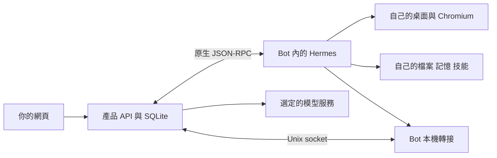

# LazyBoy

從網頁交辦工作給常駐 Bot，執行核心是 Hermes Agent。每個命名 Bot 有自己的持久 Linux 桌面、Chromium、檔案、登入、對話上下文、記憶與技能。從網頁聊天、交辦、補充、停止，或開啟電腦直接接手；不需要 Telegram。

專案位於 `/home/daniel/Projects/LazyBoyHermes`，與原本的 LazyBoy2 分開。原專案的聊天、登入與資料沒有搬入。

## 啟動

這臺主機已安裝依賴、建置前端及 Docker 映像。

若要關閉舊版 LazyBoy2 的 API、開發前端、電腦及分類器／閘道，再載入新版 Hermes，請在可存取主機 Docker 的終端執行：

```bash
python3 scripts/switch-to-hermes.py
```

切換指令先檢查權限並建置，成功後才停止舊服務；保留資料和舊版 Docker volumes，更新 Hermes 電腦映像，重開原先運行中的 Hermes 電腦，並檢查新版分流 API。若原有分類器在運行，也會啟動新版分類器並等待暖機。切換時明確使用 `0.0.0.0`，並核對新版服務 PID 持有的監聽 socket；舊版 8787／5173 未關閉時不會宣稱切換完成。`--check` 只列出切換範圍，不啟停服務。

若新版已運行，只需要停止舊版的全部程序與容器：

```bash
python3 scripts/switch-to-hermes.py --stop-old
```

此模式保留正在運行的新版，不重建映像。程序掃描支援重建後標成 `(deleted)` 的舊執行檔；先給予正常停止的時間，逾時才終止已確認身分的程序及子程序。

單獨啟動 Hermes 服務：

```bash
cd /home/daniel/Projects/LazyBoyHermes
make start
```

打開 **http://localhost:8790**。停止產品服務：

```bash
make stop
```

執行 `make` 或 `make help` 可查看指令。也可以執行 `./scripts/start.sh` 在終端前景運行。關閉網頁不會停止正在工作的 Bot；停止產品服務會中斷工作，保留檔案與對話，重啟後不會重放結果未知的操作。Bot 電腦容器會保留，重新交辦時會連回。

## 第一次安裝到別臺 Linux 主機

需要 Docker、Node/npm 和 uv。使用固定的 Hermes 原始碼及依賴鎖檔：

```bash
./scripts/bootstrap.sh
./scripts/start.sh
```

第一次在網頁「設定 → 模型」的供應商選單挑一個「Hermes 內建」供應商（OpenRouter、Anthropic、OpenAI、DeepSeek、Gemini、OpenCode 等 40 餘個），服務網址與 API 介面會自動帶入，只需貼上 API key；離開金鑰欄位時會自動載入模型清單。清單外的服務選「自訂 OpenAI 相容服務…」，自行填寫基底網址（通常以 `/v1` 結尾）並選擇 Chat Completions、Responses 或 Anthropic Messages 介面。供應商金鑰保留在產品服務端；Bot 只有自己的連線憑證。

內建清單存在 `server/hermes_providers.json`，由 Bot 映像裡的 Hermes 匯出；升級 Hermes 並重建映像後執行 `make providers` 更新。

依模型支援的能力設定推理強度及「讀取圖片」；未指定推理強度時使用 medium。模型設定的變更在下一次工作生效。供應商提供生圖介面時才開啟「產生圖片」，讓它可用於製作 Bot 頭像。

安裝前可執行 `./scripts/bootstrap.sh --check-only` 檢查 Git、uv、Node 20 以上、npm、Docker daemon 與 Compose。安裝後執行 `python3 scripts/doctor.py --ready` 核對版本及安裝產物；`--static` 只檢查檔案與工具版本。

「設定 → 模型 → 對話與工作分流」可選聊天、工作與備援模型，以及各自的推理強度、等待上限。工具工作開始後會升級到工作模型；限流或連線失敗時依序備援，開始串流後不重播。Bot 自己指定的模型優先。單組分流模型使用相同 API 介面，不同 Bot 可使用不同介面。

Semantic Router／Laya 使用可選的本機服務：`./scripts/routing.sh start`，預設 port 為 `8778`。服務會下載及暖機模型；就緒後可在分流進階設定啟用。預設只記錄分類，取消此選項後才採用高信心分類；不確定或不可用時交給工作模型。也可用 `./scripts/bootstrap.sh --with-routing` 一起安裝。`./scripts/routing.sh stop` 只停止此專案的分類器。

這臺主機已匯入原 LazyBoy 的供應商設定。另一次手動匯入只會移轉模型設定：

```bash
uv run python scripts/import-settings.py /path/to/providers.json
```

已有設定時不會覆蓋；明確要替換時加 `--force`。

## 使用方式

- 左側建立或選擇 Bot，設定名字、人設、外觀與模型。未指定模型時使用全域預設值。
- 在對話中交辦工作。工作中傳送補充會送進當前 Hermes；每個 Bot 同時只執行一個任務。
- 同一個 Bot 可以開多個對話串，類似 Hermes 在 Telegram 的 threads：聊天標題旁的「新對話」建立新串，上方分頁切換。每串對應自己的原生 Hermes session，有獨立上下文與標題（Hermes 會自動命名，也可以手動改名）；記憶、技能、檔案與電腦則共用。一臺電腦一次只做一件事，其他對話串的訊息會排隊，並顯示 Bot 正在哪一串工作。
- 回覆以聊天適用的 Markdown 呈現：標題、清單、勾選清單、表格、引用、程式碼區塊（語法上色、可複製），保留單一換行，中文旁的粗體也能正確顯示。
- 點「電腦」看它使用的桌面。你和 Bot 操作同一個瀏覽器；需要登入時直接在這個面板登入。不同 Bot 的登入彼此分開。
- Hermes 提問時在卡片回答，支援多題、複選、允許操作與秘密輸入。秘密答案不會寫進產品對話或事件紀錄。
- 工作中只顯示一行「思考中」與目前步驟；完成後過程收在答案上方的「已完成 · N 個步驟」，點開才看細節。
- 工作產出的檔案放在 `/workspace`。答案下方只列最重要的 3 個檔案；檔案面板預設隱藏建置輸出、快取與 log，按「顯示全部」可查看。上傳的檔案也進入該 Bot 的工作目錄。
- 寫程式、建專案、修 bug 時，Bot 會用內建的 `grok-build` 技能交給 Grok Build CLI（`grok`），自己驗收並回報摘要。第一次使用前，在該 Bot 的「電腦 → 終端機」執行 `grok login`。
- 在 Bot 設定管理技能與 MCP。技能是 Hermes 真正讀取的 `SKILL.md`，不是另一套只顯示在網頁的筆記。
- 「定時任務」管理例行工作，也可以請 Bot 用工具建立。產品只使用一個排程器；離線期間錯過的例行工作恢復後補一次。Bot 修改排程時可以只給要改的欄位，其餘保留。清單會顯示下次與上次執行（含結果）；無法開始執行時會在 1、5、15、60 分鐘後重試，不會重複觸發同一次。排程觸發的訊息在對話中以「定時任務」卡片呈現，可展開看內容。
- 分享檔案包含角色、技能與去除秘密的 MCP 設定。匯入會建立新的獨立 Bot，不複製聊天、記憶、API key 或瀏覽器登入。缺少的 MCP 驗證資料需重新填寫。
- 示範錄影會保留影片、截圖、時間與說明。加入對話後，Hermes 會收到素材路徑與說明；使用支援圖片的模型時，也會收到最多四張依時間取樣的畫面。只有真的寫成技能，才會出現在技能清單。

## 電腦與資料

Bot 的「自己的電腦」是本機 Docker 裡的完整 Linux 工作桌面。它能操作這個桌面、使用瀏覽器、執行指令及管理檔案。沒有掛載使用者日常主機的工作目錄或 Docker socket。

每個 Bot 預設最多使用 2 CPU、3 GB 記憶體和 512 MB shared memory。CPU 上限以 10 ms 為一期分配，Bot 的 Chromium 忙碌時，電腦畫面和你的輸入不會被凍結整整 100 ms。舊電腦會在下次「重新啟動電腦」或停止後再開時套用新設定，不會中斷運行中的桌面。電腦面板切到檔案或瀏覽器分頁放到背景 15 秒後，畫面串流會暫停，切回時立即恢復；畫面斷線會先在原頁面自動重連。資料在 `.data/bots/<bot-id>/`：

| 目錄 | 內容 |
| --- | --- |
| `hermes/` | Hermes 設定、原生對話資料、記憶、技能、秘密設定 |
| `home/` | 桌面與 Chromium 持久 profile |
| `workspace/` | 上傳檔案、工作成果及示範素材 |

產品資料在 `.data/product.sqlite3`，模型設定在 `.data/settings.json`。停止服務並備份整個 `.data/` 即可保留完整狀態。刪除 Bot 會刪除它的容器與獨立資料；清除或刪除某個對話串只影響那一串，會開始新的 Hermes 對話，但保留檔案、技能及登入。

## 手機或其他裝置

服務預設監聽主機的 `8790` port。本機 localhost 自動連線；其他裝置會先要求登入碼。登入碼在工作主機的私有檔案：

```bash
make get-access-token
```

在其他裝置開啟 `http://<工作主機 IP>:8790`，輸入登入碼。跨網路存取可放在自己的 HTTPS 反向代理後面。瀏覽器錄影及系統剪貼簿功能需要瀏覽器允許的安全來源，localhost 或 HTTPS。

## 執行架構



`server/` 負責產品資料、持久任務識別、事件、排程和 Worker 連線；Hermes 自己負責模型與工具迴圈。使用原生 TUI gateway 的雙向 JSON-RPC，沒有把 Hermes 當成另一層模型 function call。瀏覽器工具連到使用者能看見的同一個 Chromium CDP。

固定 Hermes 版本記錄於 `HERMES_VERSION`。上游原始碼保留在 `vendor/hermes-agent`，不修改它的執行核心。`box/desktop_mcp.py` 和 `box/product_mcp.py` 提供自己的桌面與產品工具。模型及產品工具透過本機 socket 回連服務，避免依賴容器到主機的網路開放。

## 前端

`web/` 是 React 19 + Vite + TypeScript 的單頁應用，由產品服務直接提供 `web/dist`。

- `src/workspace/`：主要工作區。左側 Bot 清單，中間對話，右側可切換「電腦」與「檔案」面板；手機改為分頁。`useSession.ts` 管理對話紀錄、對話串、SSE 事件與工作狀態，`Conversation.tsx`（含工作進度卡片）、`Composer.tsx`、`Threads.tsx`、`QuestionCard.tsx` 分別負責對話、輸入框、對話串分頁與提問；Hermes 的提問固定在輸入框上方作答。
- `src/markdown-engine.tsx`：延遲載入的 Markdown 引擎（react-markdown、GFM、CJK 修正、換行、highlight.js），不拖慢首屏。
- `src/styles/app.css`：設計 token 與所有版面樣式，支援深色與淺色。
- 舊版本機「群組聊天」只存在瀏覽器、沒有後端，改版時已移除；Bot 群組（分類）仍保留。

## 開發與檢查

```bash
./scripts/check.sh
./scripts/check.sh --native
npm run test:e2e --prefix web
```

第一個指令檢查產品資料、API、去重、隔離、互動協定及前端建置。`--native` 使用可丟棄的真實 Hermes 容器與本機測試模型，驗證檔案、瀏覽器與桌面、多題澄清、技能、記憶、分享、排程、補充、停止、模型切換、重啟恢復、圖片、錄影示範、推理設定、三種模型介面的完整工具流程，以及聊天升級與備援；不呼叫付費模型，也不操作正式 Bot。

Playwright 測試在 `web/e2e/hermes/`，以桌面及手機畫面執行（`test:e2e:desktop`、`test:e2e:mobile` 可只跑一種）。`product.spec.ts` 需要正在執行的產品服務，預設連到 `http://127.0.0.1:8790`（可用 `E2E_BASE_URL` 改），建立自己的驗收 Bot 並在結束時刪除，涵蓋模型、技能、分享匯入、上傳、排程、登入及原生 MCP。`workspace.spec.ts` 等其他測試載入 production build、攔截 API，驗證串流進度、補充與停止、提問卡片、輸入框、Markdown 與對話串。舊版前端的 legacy 測試已隨舊介面移除。

開發前端使用 `npm run dev --prefix web`，網址 `http://localhost:5174`，API 仍連到 `8790`。可透過 `LAZYHERMES_PORT`、`LAZYHERMES_BIND`、`LAZYHERMES_DATA_DIR`、`LAZYHERMES_IMAGE` 改變服務配置。請使用 `scripts/start.sh` 啟動後端，讓 HTTP 與 Worker socket 都由同一個服務程序管理。

研究背景在 [產品架構研究](docs/PRODUCT-RESEARCH-2026-10-07.md)。實際整合的驗收證據在 [驗收紀錄](docs/ACCEPTANCE.md)，最新修復、回歸與尚未等同原版的範圍在 [續作檢查](docs/CONTINUATION-AUDIT-2026-10-07.md)。

2026-10-08 補上的自動路由、安裝檢查、跨日回歸與同條件比較流程，見 [流程補齊紀錄](docs/WORKFLOW-COMPLETION-2026-10-08.md)。
