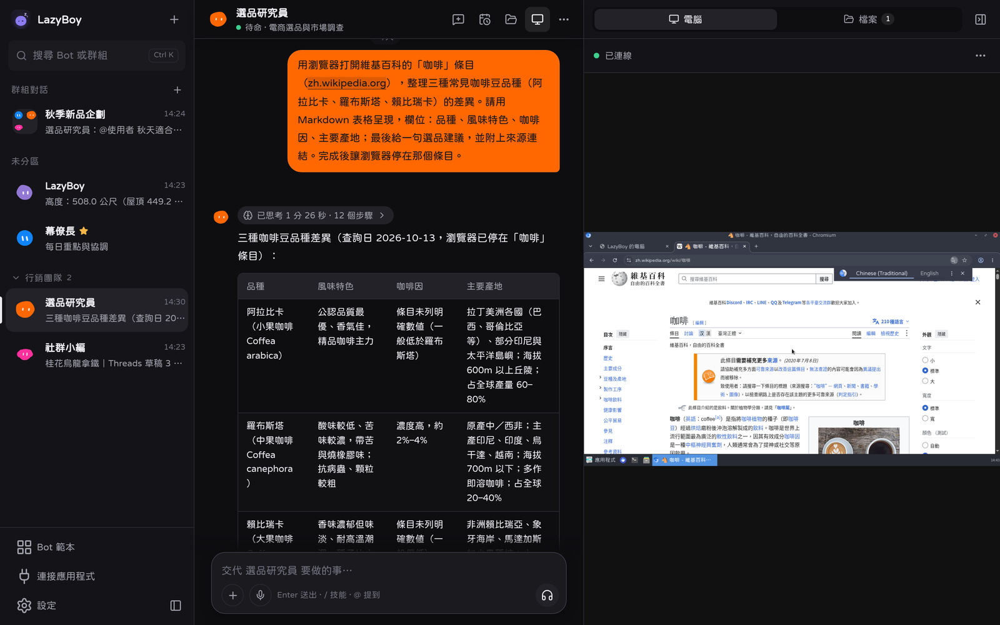
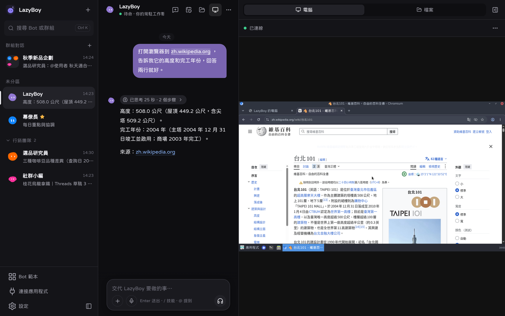
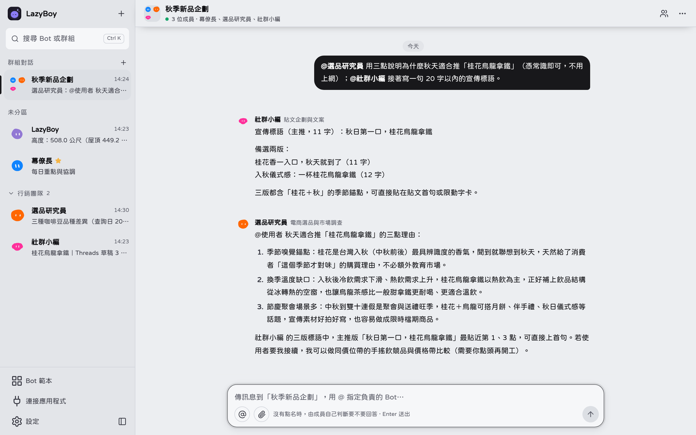
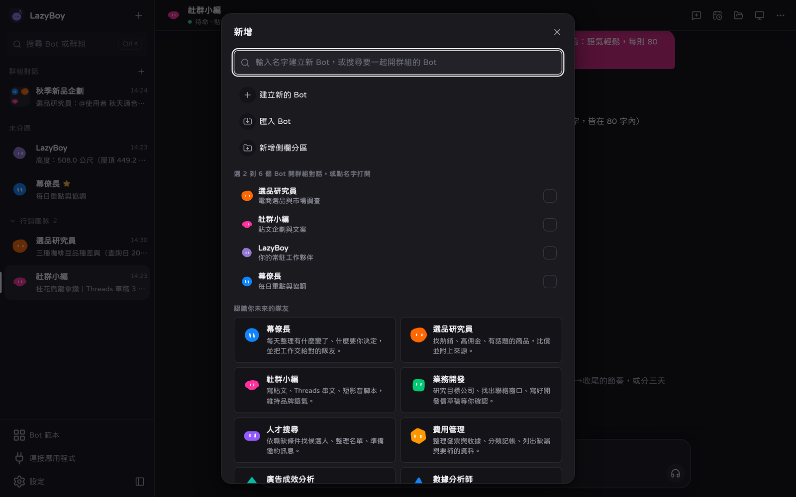
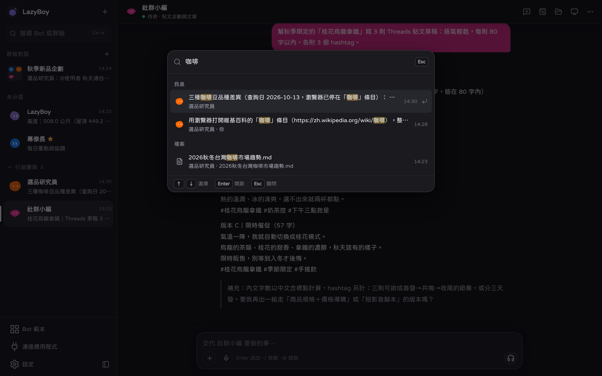
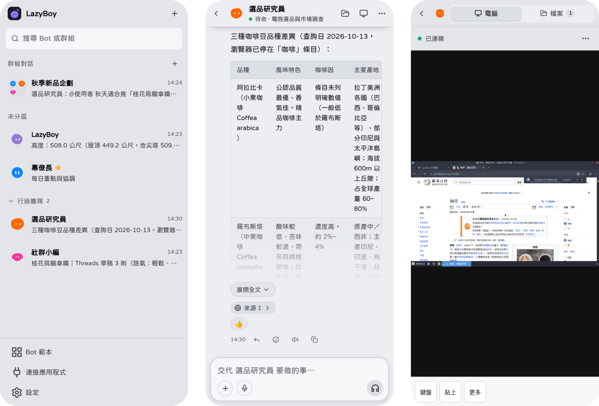
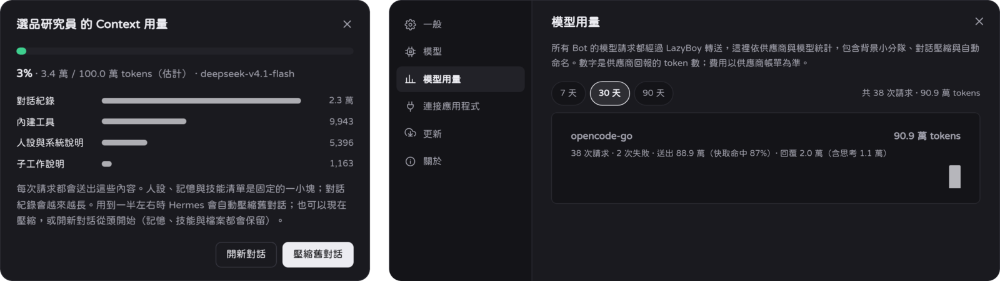
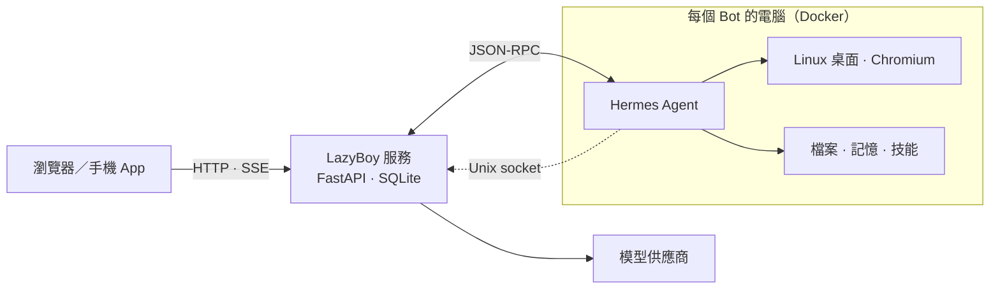

<div align="center">


# LazyBoy

**自架的 AI 工作團隊：每個 Bot 都有自己的 Linux 電腦，你在網頁交辦，它動手完成。**

[](pyproject.toml)
[](web/package.json)
[](INSTALL.md)
[](HERMES_VERSION)

[功能](#功能) · [安裝](#安裝) · [使用說明](docs/GUIDE.md) · [給 AI Agent 的安裝指引](INSTALL.md) · [架構](#架構)

</div>

<br>



## LazyBoy 是什麼

LazyBoy 是一個可以自己架設的 AI Bot 工作平台。每個 Bot 在 Docker 中擁有一台持久的 Linux 桌面，包含 Chromium、終端機、檔案管理與 LibreOffice，並由 [Hermes Agent](https://github.com/NousResearch/hermes-agent) 負責思考與使用工具。你像傳訊息一樣交辦工作，看著它查資料、操作瀏覽器、產出檔案；需要時直接打開它的電腦接手。

- **每個 Bot 一台電腦**：網站登入、檔案與瀏覽器狀態都會保留，下次接著做。
- **過程看得見**：計畫、每一步、引用的來源與產出的檔案都留在對話中。
- **像團隊一樣分工**：Bot 之間可以互傳訊息，也能在群組裡一起完成一件事。
- **模型自己選**：支援 40 多個供應商與任何 OpenAI 相容服務，每個 Bot 都能用不同的模型。
- **資料留在自己手上**：對話、記憶、登入與檔案都存放在你的主機。

## 功能

### 交辦工作，過程看得見

工作中會顯示 Bot 列出的計畫與目前步驟；完成後可以展開每一步、查看引用的來源，產出的檔案可以直接預覽或下載。工作進行中隨時可以補充說明或停止。

交代方向後由 Bot 自己做到完成：有拿不準的關鍵選擇會一次問完，之後不會每一步都問「要我…嗎？」。如果一輪工作停下時計畫還沒做完、又不是需要你登入、付款或核定，Bot 會**自動繼續**（對話裡顯示「自動繼續：計畫還有 N 項沒完成」），最多再做兩輪；你送出新訊息時，你的訊息優先。回覆一律是台灣繁體中文，模型偶爾冒出簡體時會自動轉換（程式碼不動）。

### 每個 Bot 都有自己的電腦



Bot 使用的桌面即時顯示在畫面上。遇到登入或驗證碼時，你直接在同一個瀏覽器操作，完成後交還給 Bot。也可以「教它一件事」：親自示範一次，Bot 會整理成可以重複使用的技能。

### 團隊與群組對話



把 2 到 10 個 Bot 拉進群組，用 `@名字` 指定誰負責下一步，或讓成員自行判斷要不要回答。Bot 也會主動傳訊息請隊友幫忙，再把結果整合後回報你。

### 組織架構：主管帶團隊，重大事項由你核定

- **報告關係**：在「組織架構」（側欄底部）或 Bot 設定裡設定每個 Bot「向誰報告」，沒有設定的直接向你報告。主管用 `team_status` 就能看到底下每個人正在做什麼、排了什麼、最近完成什麼、卡在哪，不必一直傳訊息追問，整理後再向上回報。
- **建立團隊**：「新增 → 建立團隊」有工程團隊（前端、後端、QA、DBA、DevOps）、公司組織（AI 執行長加七個職能）、行銷團隊三種範本，也可以自訂。一次建好主管和成員、同名的側欄分區，還可以順便開團隊群組對話，並讓主管每個工作日 18:00 回報進度。新 Bot 第一次收到工作時才開機。
- **團隊管理權限**：在 Bot 設定開啟後，可以直接跟它說「幫我建一個工程團隊」，它會先和你確認名單，再用 `create_team` 建好；也能用 `update_bot` 調整其他 Bot 的職稱、人設、報告對象和分區。它不能刪除 Bot。
- **只有你能決定的事**：預設是新商品定價、新增支出、簽約、上架、重要對客承諾，可以在組織架構裡增減。Bot 遇到這些事會用 `request_approval` 送到側欄最上方的「待你核定」，**不會過期**；你按核准或退回（可附備註）後，結果會用你的名義回到那個 Bot 的對話，它才繼續。主管或隊友說可以都不算數。

### 從範本開始



幕僚長、選品研究員、社群小編、業務開發、數據分析師等範本，已經寫好職責、使用的工具與行為界線，一鍵就能建立。調整好的 Bot 也能存成自己的範本，或匯出分享給別人。

### 搜尋與鍵盤操作



`Ctrl+K` 搜尋所有 Bot、群組、對話內容、檔案與定時任務。輸入框打 `/` 選技能、打 `@` 提到隊友；另外還有完整的鍵盤快速鍵、語音輸入與語音對話。

### 手機也能用

<p align="center"></p>

安裝成 App 之後，對話、交辦與接手電腦都能在手機上完成。LazyBoy 自帶 HTTPS，在「設定 → 其他裝置與 App」用手機掃兩個 QR code，就能信任憑證並直接登入。Android 上還能從其他 App 直接把文字與連結分享給 Bot。

### 掌握 context 與花費



看清楚人設、工具、技能、記憶與對話紀錄各佔多少 context，可以一鍵壓縮舊對話；並依供應商與模型統計每天的 token 用量與快取命中率。

### 還有更多

- **定時任務**：單次、每天、平日、每週、每月、每隔 N 分鐘，或由 Webhook 網址觸發。可以設「時間飄移」，每次在設定時間後 N 分鐘內隨機執行，發文時間不會天天一樣。跟 Bot 說「每天幫我發」，它會自己建立定時任務。
- **連接應用程式**：Notion、GitHub、Linear、Figma、Canva 等 60 多個 MCP 服務；登入一次所有 Bot 共用，每個工具都能單獨開關。
- **技能與記憶**：直接檢視與編輯 Hermes 的技能（`SKILL.md`）與記憶。
- **先問我**：寄出訊息、公開發佈、付款與刪除資料之前，Bot 會先等你同意。你在對話中時它會直接問；定時任務或隊友交辦的工作則送到「待你核定」，不會因為你沒即時回覆而作罷。
- **分享登入**：把一個 Bot 已經登入的網站分享給其他 Bot，不必重新登入。
- **淺色與深色主題**、系統通知、未讀標記、多個對話串與草稿保留。

完整操作請見 [使用說明](docs/GUIDE.md)。

## 安裝

### 系統需求

| 項目 | 需求 |
| --- | --- |
| 作業系統 | Linux x86_64，使用 apt（Debian、Ubuntu）、dnf（Fedora）、pacman（Arch）或 zypper（openSUSE） |
| 權限 | 能使用 `sudo`（只有安裝缺少的系統套件時需要） |
| 硬體 | 建議 8 GB 以上記憶體、20 GB 以上可用磁碟空間 |

git、curl、Docker（含 Buildx）、Node.js 20 以上與 [uv](https://docs.astral.sh/uv/) 等軟體，缺少時 `make install` 會自動安裝。

### 快速開始

```bash
git clone https://github.com/igs170911/LazyBoy.git ~/LazyBoy
cd ~/LazyBoy
make install   # 安裝缺少的套件與依賴，並建置網頁與 Bot 的電腦映像
make start
```

打開 <http://localhost:8790>，到「設定 → 模型」選擇供應商、貼上 API key、選擇模型，看到「✓ 可以使用」就能開始交辦工作。

- `make install` 只會安裝缺少的東西，重新執行也安全。系統套件透過發行版的套件管理員安裝（會詢問 sudo 密碼）；Node.js 與 uv 裝在 `~/.local`，不需要 sudo。沒有 `make` 時改用 `./scripts/install.sh`。
- 建置映像前會先測試各 Debian 鏡像站的速度，自動選用最快的一個。要指定鏡像站時，設定 `DEBIAN_MIRROR`，例如 `DEBIAN_MIRROR=http://free.nchc.org.tw/debian make install`。
- 只想知道缺少什麼、不做任何變更時，執行 `./scripts/install.sh --check`。

### 用 Docker 執行

不想在主機安裝 Node.js、uv 等工具時，可以讓 LazyBoy 整個在 Docker 裡執行。主機只需要 git 和 Docker Engine 26 以上（含 Buildx 與 Compose），支援 linux/amd64 與 linux/arm64。

```bash
git clone https://github.com/igs170911/LazyBoy.git ~/LazyBoy
cd ~/LazyBoy
make build   # 先確認建置平台，再建置 LazyBoy 與 Bot 電腦的映像
make up      # 啟動，並顯示含登入碼的網址
```

`make up` 會列出這台電腦和區網裝置用的網址（其他裝置用 HTTPS），網址裡已含登入碼，打開一次之後瀏覽器會記住。其他裝置第一次連線前要先信任憑證，見[從手機或其他裝置連線](#從手機或其他裝置連線)。

- 資料放在 Docker volume `lazyboy-data`，Bot 的電腦從同一個 volume 掛載自己的資料夾，也透過專用的 Docker 網路連線。檔案權限完全由 Docker 管理，不受主機使用者、rootless Docker 或 userns-remap 影響，Bot 電腦也不會對主機開放任何 port。
- 在 Docker 中執行時，所有連線（包含本機）都需要登入碼；`make docker-token` 可以再顯示一次。
- 已經用 `make install` 安裝過的話，先 `make stop`，再執行 `make docker-import` 把 `.data/` 複製到 volume（原資料夾不會改動），然後 `make up`。
- 沒有 `make` 時，改用 `./scripts/build-images.sh --server` 與 `./scripts/docker-up.sh`。

### 讓 AI Agent 幫你安裝

[INSTALL.md](INSTALL.md) 是寫給 AI coding agent 的逐步安裝指引，每一步都附有驗證方式。把下面這段話交給 Claude Code、Codex 或其他 agent 即可：

```text
請依照 https://github.com/igs170911/LazyBoy/blob/master/INSTALL.md 在這台電腦安裝 LazyBoy。
需要 sudo 或安裝系統套件前先問我，完成後告訴我網址和下一步。
```

## 使用

### 常用指令

| 指令 | 說明 |
| --- | --- |
| `make install` | 安裝缺少的套件與依賴，並建置網頁與 Bot 的電腦映像；第一次安裝與更新都用它 |
| `make start` | 在背景啟動服務，日誌寫在 `.run/server.log` |
| `make stop` | 停止服務；Bot 的檔案、對話與登入都會保留 |
| `make get-access-token` | 顯示其他裝置使用的登入碼 |
| `make box` | 只重建 Bot 的電腦映像（自動選最快的 Debian 鏡像站），完成後在「設定 → 更新」套用 |
| `make providers` | 從 Bot 映像中的 Hermes 重新匯出內建供應商清單 |
| `make clean` | 清除用不到的 Docker 建置快取與無名映像，不影響 Bot 的資料 |
| `make build` | Docker 執行方式：確認建置平台（linux/amd64 或 linux/arm64）後，建置 LazyBoy 與 Bot 電腦的映像 |
| `make up` / `make down` | Docker 執行方式：啟動或停止 LazyBoy；資料保留在 `lazyboy-data` volume |
| `make logs` | Docker 執行方式：查看日誌 |
| `make docker-token` | Docker 執行方式：顯示登入碼 |
| `make docker-import` | 把 `make install` 版本的資料複製到 Docker volume |

關閉網頁不會中斷 Bot 的工作。停止服務會中斷進行中的工作，但不會重放結果未知的操作；Bot 的電腦容器會保留，下次交辦時自動連回。

### 從手機或其他裝置連線

服務監聽所有網路介面：`8790` 是 HTTP，`8791` 是 HTTPS。在主機本機可以直接使用；其他裝置請打開「設定 → 其他裝置與 App」：

1. **安裝憑證**：用手機掃描第一個 QR code，下載並信任 LazyBoy 的憑證。頁面上有 iPhone、Android、Windows、macOS 與 Linux 的步驟，每台裝置只需要做一次。
2. **開啟並登入**：掃描第二個 QR code，會用 HTTPS 開啟 LazyBoy 並直接登入，接著就能安裝成 App。

瀏覽器只允許從 HTTPS 網址安裝 App、使用麥克風與通知，所以其他裝置請使用 HTTPS。也可以手動開啟 `https://<主機 IP>:8791`，再輸入 `make get-access-token` 顯示的登入碼。

- 憑證由 LazyBoy 在第一次啟動時產生，存在 `.data/tls/`。它只能用在私人網路位址與本機名稱，即使外流也無法冒充其他網站。之後換 IP 或更新憑證都不必重新信任。
- 在外面也想連線時，建議用 [Tailscale](https://tailscale.com/) 這類 VPN 連回主機；不要把 port 直接開到網際網路。
- 只想在本機使用時，設定 `LAZYHERMES_BIND=127.0.0.1`；不需要 HTTPS 時，設定 `LAZYHERMES_HTTPS_PORT=0`。

### 更新

```bash
git pull
make install
make stop && make start
```

用 Docker 執行時，改為 `git pull && make build && make up`。

更新後，到「設定 → 更新」或 Bot 電腦選單的「更新電腦環境」，讓既有的 Bot 改用新的映像。

## 資料與安全

- **資料位置**：所有資料都在 `.data/`，包含產品資料庫、模型設定、登入碼，以及每個 Bot 的 Hermes 設定、記憶、技能、瀏覽器 profile 與工作檔案。停止服務後備份整個目錄，就能保留完整狀態。詳見 [資料與備份](docs/GUIDE.md#資料與備份)。
- **隔離**：每個 Bot 的電腦都是獨立的容器，有 CPU 與記憶體上限，不掛載主機的工作目錄或 Docker socket。不同 Bot 的登入與檔案彼此分開。
- **金鑰**：模型供應商的 API key 只保存在 LazyBoy 服務端。Bot 的模型請求經由本機 Unix socket 交給服務代理，電腦裡拿不到金鑰。
- **Docker 執行方式**：LazyBoy 的容器會掛載 Docker socket 來開關 Bot 的電腦，這等同主機的 root 權限，與 `make install` 版本要求使用者在 docker 群組相同。Bot 的電腦本身仍然拿不到 Docker socket。
- **存取控制**：localhost 以外的連線都需要登入碼。登入碼存在 `.data/access-token`（權限 600），也可以用 `LAZYHERMES_ACCESS_TOKEN` 指定。

## 架構



- **LazyBoy 服務**（`server/`）：FastAPI 應用，負責 Bot、對話、工作、事件串流、排程與模型代理，資料存放在 SQLite；網頁前端也由同一個服務提供。
- **Hermes Agent**（`vendor/hermes-agent`，版本固定在 `HERMES_VERSION`）：在每個 Bot 的容器中執行，負責模型與工具迴圈。LazyBoy 透過 Hermes 原生 TUI gateway 的雙向 JSON-RPC 溝通，不修改它的核心。
- **Bot 的電腦**（`box/`）：Debian、TigerVNC、XFCE、Chromium 與 LibreOffice，畫面透過 noVNC 顯示在網頁上。`box/desktop_mcp.py` 與 `box/product_mcp.py` 提供桌面與產品工具；模型請求與產品工具都經由本機 Unix socket 回到服務，容器不需要連線到主機的網路。
- **網頁前端**（`web/`）：以 React 19、TypeScript 與 Vite 建置的單頁應用，可以安裝成 PWA。

## 設定參數

| 環境變數 | 預設值 | 說明 |
| --- | --- | --- |
| `LAZYHERMES_PORT` | `8790` | HTTP port |
| `LAZYHERMES_HTTPS_PORT` | `8791` | HTTPS port，給手機與其他裝置使用；設為 `0` 關閉 |
| `LAZYHERMES_BIND` | `0.0.0.0` | 監聽位址；設為 `127.0.0.1` 時只允許本機連線 |
| `LAZYHERMES_DATA_DIR` | `.data` | 資料目錄 |
| `LAZYHERMES_IMAGE` | `lazyhermes-bot:local` | Bot 電腦使用的 Docker 映像 |
| `LAZYHERMES_ACCESS_TOKEN` | 自動產生 | 其他裝置的登入碼 |
| `DEBIAN_MIRROR` | 自動測速選擇 | 建置 Bot 電腦映像時使用的 Debian 鏡像站（`make install`、`make box`、`make build`） |
| `PLATFORM` | Docker 的原生平台 | `make build` 的建置平台：`linux/amd64` 或 `linux/arm64` |
| `LAZYBOY_PORT` / `LAZYBOY_HTTPS_PORT` | `8790` / `8791` | Docker 執行方式對外的 HTTP 與 HTTPS port |
| `LAZYBOY_VOLUME` | `lazyboy-data` | Docker 執行方式的資料 volume |

## 開發

```bash
./scripts/check.sh            # 後端測試與前端建置（含型別檢查）
./scripts/check.sh --native   # 另外用可丟棄的真實 Hermes 容器做整合測試，不呼叫付費模型
npm run test:e2e --prefix web # Playwright 端對端測試（桌面與手機）
npm run dev --prefix web      # 前端開發伺服器 http://localhost:5174，API 連到 8790
```

`web/e2e/hermes/product.spec.ts` 會連到執行中的服務（預設 `http://127.0.0.1:8790`，可用 `E2E_BASE_URL` 指定），建立自己的驗收 Bot 並在結束時刪除；其他 Playwright 測試同樣經由服務載入已建置的前端，但會攔截所有 API，不會動到真實資料。

```text
server/    FastAPI 服務：Bot、對話、工作、事件、排程與模型代理
box/       Bot 電腦的映像：桌面、瀏覽器、Hermes 轉接與工具
web/       React 前端與 Playwright 測試
scripts/   安裝、啟動、停止與檢查腳本
tests/     後端測試（pytest）
docs/      使用說明與設計文件
```

## 致謝

LazyBoy 建立在這些開源專案之上：[Hermes Agent](https://github.com/NousResearch/hermes-agent)、[noVNC](https://github.com/novnc/noVNC)、[TigerVNC](https://tigervnc.org/)、[XFCE](https://www.xfce.org/)、[Playwright](https://playwright.dev/)、[FastAPI](https://fastapi.tiangolo.com/)、[React](https://react.dev/)，以及 [jf open 粉圓](https://github.com/justfont/open-huninn-font) 字型。
