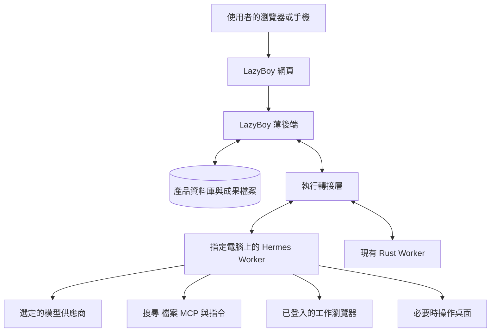

# LazyBoy 產品比較與 Hermes 執行架構評估

> 這是建立新版前的研究紀錄。文中「目前系統」指 LazyBoy2；新版的實際使用方式見 [README](../README.md)，驗證結果見 [整合驗收](ACCEPTANCE.md)。

日期：2026 年 10 月 7 日。對象：Daniel。範圍：目前工作目錄中的 LazyBoy、三次實際蝦皮任務、相關產品的官方文件，以及 Hermes 官方原始碼。

**建議保留 LazyBoy 的網頁操作方式，將 Hermes 列為可替換的 Agent 執行核心，先用同條件比較決定是否遷移。** 你的產品已經有常駐 Agent、對話、任務、記憶、技能及電腦介面。現在最需要改善的是工作能否有效推進、遇到阻礙能否正確處理，以及結果是否符合原始要求。

Hermes 可以接自訂網頁，也可以在本機或隔離環境裡執行，不需要 Telegram。它值得參考的地方是完整執行核心、瀏覽器操作、工具整合及互動協定。你的後端可以大幅變薄，但仍應負責使用者與機器的對應、任務提交、狀態同步及成果儲存。

「Agent 直接操作我的電腦」有機會改善登入與工具可用性，但不會自然消除慢速。三次蝦皮任務的模型請求數分別是 168、109、81 次；大量往返、失敗重試和完成標準不清，比前端畫面速度更值得優先處理。

## 你想要的產品形態

我把你的想法理解成：

> 我保留自己設計的網頁與操作邏輯。使用者在網頁選 Agent、聊天、交辦工作、檢視它操作電腦，也能中途補充或停止。Hermes 之類的 Agent 常駐在真正執行工作的電腦上，使用那臺電腦的瀏覽器、檔案與工具。我的後端主要儲存產品資料，並連線網頁和 Agent。我不用 Telegram 當主要入口，也希望少維護一整套 Agent 核心。

這個方向同時包含三個決定，效果應分開評估：

| 決定 | 改變什麼 | 對速度的可能影響 |
| --- | --- | --- |
| 保留自訂網頁，接 Hermes | 替換模型與工具的執行迴圈，沿用你的操作方式 | 若它減少無效輪次、改善工具選擇，可能明顯改善 |
| 從獨立 Docker 瀏覽器改成已登入的本機瀏覽器 | 更換工作環境與登入來源 | 可能省去重登與部分環境問題；不保證網站不再驗證 |
| 讓後端主要管理資料與連線 | 把執行核心交給本機 Worker | 主要減少維護責任；網路轉送不是目前最大耗時來源 |

目前 LazyBoy 本來就是在這臺電腦上執行 Rust Agent，再操作 Docker 裡的桌面。你提出的新方向，主要是**採用現成 Agent 核心，以及讓它使用更合適的工作環境**，而不是第一次把 Agent 移到本機。

「Agent 在電腦裡」也不等於模型必須在電腦裡。Hermes 可以在本機執行工具，再呼叫遠端模型；是否使用本機模型是另一個選擇。

## 現有產品的價值與缺口

LazyBoy 已有一套接近常駐同事的產品結構：React 網頁與 PWA、命名 Agent、獨立對話、背景任務、記憶與學習技能、Agent 匯出匯入、例行工作、MCP、瀏覽器工具，以及每個 Agent 的持久 Docker 桌面。Rust API 和 SQLite 保留任務及事件，網頁提供電腦檢視與接手。

目前原始碼也已經具備工具批次、動作後觀察、讀取結果去重、重複讀取防護、模型路由和電腦修復。這些不能再當成「尚未實作」的最佳化提案。產品文件部分仍寫著 MVP 或進行中，評估以目前原始碼與實際紀錄為準。[產品說明](../../LazyBoy2/docs/PRODUCT.md)、[工具流程](../../LazyBoy2/docs/TOOL-FLOW.md)、[電腦修復](../../LazyBoy2/docs/COMPUTER-CONNECTION-FIX.md)、[Agent 分享與學習](../../LazyBoy2/docs/AGENT-SHARING.md)

| 面向 | 目前優點 | 主要代價或缺口 |
| --- | --- | --- |
| 網頁操作 | 已有自己的對話、Agent 切換、電腦面板及 PWA | 任務活動很多，仍可能看不出已完成什麼、卡在哪裡 |
| 本機與模型控制 | 能選供應商，執行環境與資料自己管理 | 實際 Agent 模型可能覆蓋全域設定，設定與體感不易對上 |
| 電腦隔離 | 每個 Agent 有獨立 Docker 桌面和瀏覽器資料 | 帳號需分別登入；資源、CDP、VNC 與桌面生命週期都要維護 |
| 工具 | 公開網頁、登入後 DOM、桌面、檔案與 MCP 路線齊全 | 有工具名稱不等於工具已可用；錯誤會讓 Agent 選錯修復路線 |
| 任務持續性 | 儲存事件、計畫與中斷狀態，支援工作中補充 | 仍會長時間無效探索；有最終回答不等於真的完成 |
| 技能與分享 | 可把角色及工作方法保留下來並分享 | 必須驗證技能能重複完成工作，不能只儲存成功敘述 |

建議把產品定位集中在「用自己的網頁，管理能在指定電腦上完成工作的 Agent」。前端與使用者體驗由你掌握，執行核心可以替換；如此不必將每個上游工具與模型變動都變成自己維護的工作。

## 蝦皮任務實際花了多少時間

以下來自本機任務資料庫的完整 timing/runtime 事件，以唯讀方式分析。時間使用臺北時區。A 有三段 Agent 執行和中間停頓；B、C 被取消，因此是取消前已花的時間，不能當作完成時間。

| 案例 | 開始時間 | 經過時間 | Agent 活躍時間 | 模型請求 | 工具呼叫 | 結束狀態 |
| --- | --- | --- | --- | --- | --- | --- |
| A | 10 月 5 日 22:53 | 28 分 33 秒 | 27 分 18 秒 | 168 | 181 | 回答，但未驗證完成原要求 |
| B | 10 月 6 日 10:20 | 23 分 33 秒 | 23 分 33 秒 | 109 | 119 | 取消 |
| C | 10 月 6 日 15:57 | 11 分 28 秒 | 11 分 28 秒 | 81 | 80 | 取消 |

| 計時項目 | A | B | C |
| --- | --- | --- | --- |
| 模型回覆累計 | 23 分 13 秒 | 13 分 46 秒 | 5 分 42 秒 |
| 佔 Agent 活躍時間 | 約 85% | 約 58% | 約 50% |
| 工具執行累計 | 3 分 15 秒 | 9 分 12 秒 | 5 分 25 秒 |
| 每次模型回覆中位數 | 5.62 秒 | 5.28 秒 | 3.70 秒 |
| 記錄到的本機模型排隊 | 0 | 0 | 0 |

這些是分項計時累計，可能有重疊，不是精確可相加的牆鐘時間分解。`model_round_including_queue` 包含模型回覆；browser helper 的計時也可能巢狀在工具或背景工作裡，沒有再次加進表格。A 約 75 秒不在 Agent 活躍區段中，包含段落間停頓與其他開銷，未全部歸因為人類操作。

三案都是一般工作任務，資料中 `research=false`。所以不能直接拿「研究模式預算」解釋這三次耗時。

**你的慢速感受有紀錄支持，而且不只是桌面工具慢。** A 單是模型回覆就累積超過 23 分鐘。即使把 A 的工具時間假設性地全消除，仍無法把同樣的 168 次往返變成快速完成。B、C 則同時有模型往返和工具等待問題。

統計及可重跑的唯讀程式：[彙總資料](benchmarks/product-latency-audit-2026-10-07.json)、[分析程式](benchmarks/product-latency-audit.py)。彙總資料沒有對話全文、帳號名稱、登入資料或商品網址。

## 慢速與不順的主要原因

### 模型輪次太多

A 發出 58 次 `browser_navigate`，整體有 168 次模型請求。B 有 73 次 `computer`，整體仍有 109 次模型請求。C 有 81 次模型請求。多次觀察、探索、修復和等待之間都需要模型重新決策，單輪幾秒會累積成十幾分鐘。

這並不表示所有請求都無用；三個歷史樣本也不足以精確判定可刪除多少輪次。但應先減少沒有進展的往返，再比較模型的每輪速度。只把每輪變快，可能讓錯誤探索跑得更快。

### 實際模型和全域設定不同

三案保留下來的模型紀錄均為 `opencode-go / deepseek-v4.1-flash`。目前相關 Agent 也明確指定這組供應商與模型。現有程式遇到 Agent 指定 provider 時會跳過全域 chat/work 路由，因此不能將這些歷史耗時歸咎於全域設定裡的 Grok 模型或 reasoning 選項。[Agent 模型決定](../../LazyBoy2/crates/lazyboy-core/src/team/service.rs)、[路由對指定模型的處理](../../LazyBoy2/crates/lazyboy-core/src/routing.rs)

應在 Agent 設定與每次任務中顯示「要求使用的模型」和「實際使用的模型」。更換核心後也需要保留這種可見性，否則很難公平比較。

### 公開搜尋在這些任務中沒有配置成功

A、B、C 的 `web_search` 分別呼叫 3、2、1 次，全部失敗，錯誤是該 provider 沒有配置搜尋後端。單次失敗只有幾十毫秒，直接耗時很小；後續改用瀏覽器找資料，可能帶來額外輪次，但這部分沒有獨立測出因果耗時。

目前搜尋與文字模型設定有相依性，`web_fetch` 則可以直接讀取公開 URL。產品啟動或派工前應知道哪些工具真的可用，避免把未配置工具當作正常能力交給模型。[搜尋與抓取實作](../../LazyBoy2/crates/lazyboy-core/src/web.rs)

「查蝦皮分潤規則」首先是公開資料研究；「用我的帳號找佣金最高的商品」才需要登入後的帳號資料。兩種需求應走不同路線，不能看到「蝦皮」就啟動整臺桌面。

### 連線錯誤與介面阻礙沒有有效收斂

B 五次 `browser_tabs` 全部失敗，累計約 151 秒；另有 `browser_eval` 和 `browser_navigate` 各約 30 秒失敗。該案保留錯誤將 CDP 連線逾時包成 `CHROMIUM_MISSING`，提示安裝瀏覽器，而不是明確指出「已有瀏覽器但無法連線」。目前 helper 的一般啟動 catch 仍有這種錯誤分類方式。[瀏覽器連線與錯誤分類](../../LazyBoy2/tools/playwright/browser_helper.mjs)

C 有 10 次導覽、6 次失敗，9 次點選、5 次失敗。其中點選被網站 modal 遮罩擋住。對這類阻礙，需要先辨認遮罩、頁面權限與登入狀態，再選擇關閉提示、切正確分頁或請使用者處理必要步驟；不應反覆等待同一個點選成功。

C 三次 `await_shell` 累計約 91 秒。等待背景指令不一定是錯，但應區分工作確實在執行，還是用長等待反覆探測同一個問題。三案本機模型排隊皆為零，HTTP attempt 數也與模型請求數相同；這些樣本沒有顯示本機模型排隊或 HTTP 重試風暴是主因。

### 防重複機制還不能涵蓋整段無進展工作

現有防護會辨認相同讀取批次和相同結果，第三次阻擋。但遇到點選、桌面動作或 shell，觀察記錄會重置；參數、輸出或路徑改變，也可能讓語意相同的迴圈繼續。[目前防護](../../LazyBoy2/crates/lazyboy-core/src/agent.rs)

需要加入跨工具的進展判斷，例如「仍在同一登入頁」「同一 modal 仍擋住」「同一個 CDP 端點仍無法連線」。觸發後應改變方法、交接最小必要操作，或回報已取得與仍缺少的證據。這和硬把所有複雜任務切成兩分鐘上限不同。

### 桌面圖片並未自動成為模型視覺輸入

目前 `computer` 主要靠 AT-SPI 元素樹和 xdotool 動作；截圖檔路徑不是模型可看的圖片，snapshot 還會移除圖片路徑。上傳圖片的媒體功能存在，但不能據此推論電腦截圖已傳到模型。[桌面工具回傳](../../LazyBoy2/crates/lazyboy-core/src/box_runtime.rs)

DOM 和可存取元素能處理大部分表單，通常很有效率。當網站 canvas、圖形或非標準控制項無法提供足夠文字觀察時，才需要真正的圖片 payload 與支援視覺的模型。增加這條備援有價值，但讓每次點選都走截圖辨識，不一定更快。

### 結果品質也有問題

A 最後提供了候選商品與類別佣金估算，但沒有讀到要求的商品級實際佣金並驗證排名。因此「28 分鐘後有回答」不代表「28 分鐘完成最高佣金商品調查」。

這類任務的完成標準應包含實際帳號下可見的商品、佣金欄位、適用條件及排序依據。拿不到時可以交付已查明的規則、阻礙與部分資料，但不能把估算包成已驗證的最高佣金。

## 可以對標的產品與技術

比較以官方目前描述的能力為基礎。優缺點是相對 LazyBoy 需求的架構判斷；沒有用同一蝦皮帳號和任務測過它們，因此不把網站宣傳轉成速度排名。

| 對象 | 工作方式與主要優點 | 相對代價 | LazyBoy 最值得參考的部分 |
| --- | --- | --- | --- |
| Grok Bot | 常駐命名 Bot、雲端電腦、技能與例行工作；筆電關閉仍能執行 | 供應商管理執行環境；同帳號 Bot 共用電腦資源和登入 | 常駐同事的互動、共享工作環境、明確接手 |
| ChatGPT Work 與 dots | Work 做多步工作和成果；dots 持續工作，可連線雲端或本機電腦 | 可用性依帳號與推出狀態；本機工作仍依賴電腦線上 | 工作與聊天的延續、成果呈現、連線電腦的入口 |
| Claude 整合 Cowork | 對話裡完成工作；connector、瀏覽器、桌面採取不同操作路線 | 模型與產品由供應商決定；本機能力受作業系統和 Desktop 狀態限制 | 依工作選擇工具，自然延續同一段對話 |
| Manus Browser Operator | 網頁交辦，使用授權的本機瀏覽器和既有登入；可接手或停止 | 授權裝置需線上；網站限制不會因此消失 | 自訂網頁和本機工作機器分開，清楚選擇瀏覽器 |
| Hermes Agent | 自架常駐核心、多 provider、記憶技能、排程、HTTP 與 JSON-RPC 介面 | Python 核心及工具依賴仍需維護，產品資料要做轉接 | 最直接的替代執行核心候選 |
| OpenClaw | 自架 gateway、瀏覽器工具、精簡觀察及迴圈偵測 | 元件與配置需管理；不是接上就能保證完成工作 | 工具觀察格式、錯誤正規化與防迴圈策略 |
| Browser Use | 瀏覽器專用執行，支援每輪多動作、視覺及抽取模型設定 | 不是完整常駐同事產品；快速模式仍需品質取捨 | 減少瀏覽器工作的模型往返、批次動作與頁面抽取 |

### Grok Bot

它和 LazyBoy 的產品外形最接近。官方文件說明同帳號 Bots 共用一臺持久雲端電腦、檔案和登入；各 Bot 有獨立畫面，但畫面不是安全隔離邊界。這比 LazyBoy 每個 Agent 一個 Docker 桌面更方便共享登入，也減少重複環境；LazyBoy 的獨立環境則更適合不同帳號或角色需要隔離的情況。[Grok Bot 概覽](https://docs.x.ai/grok-bot/overview)、[電腦與應用程式](https://docs.x.ai/grok-bot/computer-and-apps)

值得採用的概念是把「Agent 身分」和「工作電腦」分開：多個 Agent 可以被指派到同一臺工作電腦，也能選不同隔離環境。但同一個瀏覽器頁面仍需有明確操作權，不能讓兩個工作互相導航。

### ChatGPT Work 與 dots

目前官方文件已經不只描述早期的一次性 agent mode。Work 用於研究、產出與多步工作；dots 是能持續工作的雲端 Agent，可使用電腦和應用程式。雲端登入與使用者本機登入是不同狀態；連線本機電腦時仍需要那臺電腦線上。[Work 網頁介面](https://learn.chatgpt.com/docs/web)、[dots](https://learn.chatgpt.com/docs/dots)、[連線電腦與應用程式](https://learn.chatgpt.com/docs/dots/computers-and-apps)

對 LazyBoy 的啟發是讓成果、對話和電腦操作連在一起：使用者應能看到工作結論及檔案，理解卡住的步驟並接手。LazyBoy 的供應商選擇和本機資料控制仍是自己的優勢。

### Claude 與 Cowork

官方目前正把 Cowork 和聊天整合成同一套 Claude 體驗。雲端工作與需要本機 Desktop 的工作有不同的持續執行條件。電腦操作文件也明確優先使用 connector，再使用瀏覽器，最後使用螢幕控制。[Cowork 與聊天整合](https://support.claude.com/en/articles/16761823-claude-cowork-and-chat-are-one-claude)、[讓 Claude 使用電腦](https://support.claude.com/en/articles/14128542-let-claude-use-your-computer-in-cowork)

這支持保留你的對話操作邏輯，同時讓核心選擇有效工具。使用者不必先學會「這件事應該交給 DOM、MCP 還是桌面」。LazyBoy 目前指令原則已經有類似優先順序，需要驗證執行時是否真的遵守。

### Manus

Browser Operator 與 preferred browser 的方向很貼近你的構想：從網頁交辦，把工作送到授權且線上的本機瀏覽器，利用既有登入並保留接手。這可以減少雲端環境和本機登入落差，但不能保證蝦皮永不驗證、session 永不過期或任務一定更快。[Browser Operator](https://manus.im/en/blog/manus-browser-operator)、[Preferred Browser](https://manus.im/blog/manus-preferred-browser)

可以參考它的裝置選擇與連線狀態，把「這個 Agent 在哪裡工作、使用哪個帳號」做成可理解的產品操作。

### OpenClaw 與 Browser Use

OpenClaw 的瀏覽器工具使用元素參照和精簡觀察；迴圈偵測文件描述歷史模式與正規化結果，但不能當作萬用語意防卡死。Browser Use 可以每輪執行多個動作，也能使用不同模型抽取頁面；部分快速選項會省略評估和思考，需要用完成品質一起衡量。[OpenClaw 瀏覽器工具](https://docs.openclaw.ai/tools/browser/agent-tools)、[迴圈偵測](https://docs.openclaw.ai/tools/loop-detection)、[Browser Use 參數](https://docs.browser-use.com/open-source/customize/agent/all-parameters)

它們比較適合作為執行方法的參考。LazyBoy 已經有批次和動作後觀察，下一步應研究哪些實際工作仍被切成多輪，以及如何在頁面改變時停止批次，而不是重新實作一套同名功能。

## Hermes 是否適合你的方向

**適合當首要候選，但目前不能說換上去就會比較快。** Hermes 是 MIT 授權的開源 Agent；可自架執行並使用不同模型和工具服務。程式本身的授權成本與模型、搜尋、雲端瀏覽器及主機成本應分開看。[官方網站](https://hermes-agent.nousresearch.com/)、[官方 repository](https://github.com/NousResearch/hermes-agent)

本次原始碼參考固定在 `05eecbcd972c8737ebc7722ea08aab47fb538043`，避免日後上游文件改動讓結論無法追溯。檢查了文件與介面實作，沒有在你的系統安裝或啟動 Hermes。

### 不需要 Telegram

Hermes 有 HTTP API、ACP，以及 TUI gateway 的 JSON-RPC；它們使用相同 Agent 核心。Bot Mode 還有命名角色、不同模型、記憶、技能和例行工作，與現有 LazyBoy Agent 很接近。[架構](https://hermes-agent.nousresearch.com/docs/developer-guide/architecture)、[程式整合介面](https://hermes-agent.nousresearch.com/docs/developer-guide/programmatic-integration)、[Bot Mode](https://hermes-agent.nousresearch.com/docs/user-guide/bot-mode)

所以你的選擇可以是「LazyBoy 網頁 → 本機 Hermes」，；Telegram 只是另一種入口。Hermes 自己的桌面或 dashboard 也可以當介面參考，但可以直接把核心接到你的網頁。

### 網頁工作介面已經有基礎

HTTP Runs API 可以建立工作、訂閱進度、讀取狀態、停止，並支援安全重送的 idempotency key。Sessions API 可讀取對話。它也有 capability discovery，方便轉接層先辨認當前版本支援什麼。[API Server](https://hermes-agent.nousresearch.com/docs/user-guide/features/api-server)

程式碼另有 `/v1/runs/{id}/steer`，在工作中接收補充；停止先進入 `stopping`，等實際執行退出才變成 `cancelled`。SSE 有序號與重播，但事件緩衝會到期；gateway 中斷時的狀態儲存，不等於能自動恢復任意工具的執行。[固定版本 Runs 實作](https://github.com/NousResearch/hermes-agent/blob/05eecbcd972c8737ebc7722ea08aab47fb538043/gateway/platforms/api_server_runs.py)、[重送去重實作](https://github.com/NousResearch/hermes-agent/blob/05eecbcd972c8737ebc7722ea08aab47fb538043/gateway/platforms/api_server_run_idempotency.py)

若要完整呈現澄清問題、秘密輸入、連線設定和雙向互動，官方更推薦 TUI gateway JSON-RPC。它需要宣告 client capabilities，將 gateway 發給使用者的請求轉成網頁卡片，再回送對應答案；單純的 HTTP 串流文字不會自動完成這層操作。[固定版本整合協定](https://github.com/NousResearch/hermes-agent/blob/05eecbcd972c8737ebc7722ea08aab47fb538043/website/docs/developer-guide/programmatic-integration.md)

建議先用 HTTP Runs 做效能驗證，完整產品互動再評估 JSON-RPC。兩種介面應包在同一個產品轉接層後面，同一個任務只由其中一條執行路徑負責。

### 本機瀏覽器可用，但登入不是自動繼承

Hermes 的瀏覽器功能可以連既有 Chromium 系瀏覽器，也可以啟動自己的瀏覽器。預設本機瀏覽器是乾淨環境；要利用既有登入，必須明確連線或使用 real profile 功能。real profile 是複製登入資料到管理的快照，並不等於直接共享你正在操作的那個視窗。[瀏覽器功能](https://hermes-agent.nousresearch.com/docs/user-guide/features/browser)

上游文件也說明 profile 資料庫可能被使用中的瀏覽器鎖住，可能需先退出瀏覽器再建立快照。因此「直接用我已登入的瀏覽器」需要測出實際登入、重連和同時使用的行為，不能當成零設定能力。[固定版本 profile 說明](https://github.com/NousResearch/hermes-agent/blob/05eecbcd972c8737ebc7722ea08aab47fb538043/website/docs/user-guide/features/browser.md)

### 直接操控電腦應是其中一條路線

Hermes 目前內建 `computer_use` 透過 cua-driver，支援各作業系統的元素觀察及輸入；模型支援時可以把截圖送進視覺輸入。Linux 仍需要可用 display、AT-SPI，Wayland 截圖需要 XWayland bridge。這臺電腦的桌面相容性應在驗證時確認。[Computer Use](https://hermes-agent.nousresearch.com/docs/user-guide/features/computer-use)

它自己的文件也把登入瀏覽器操作放在 browser 工具路線。對蝦皮這種網站，合理順序仍是公開搜尋或直接抓取、已登入的 DOM 操作，最後才是桌面視覺與滑鼠。桌面操作比較有感，不代表效率比較高。

Hermes 的 `browser_exec` 可在一次呼叫裡執行多個瀏覽器步驟，這是值得測試的減少往返方法。多個命名 browser session 能隔離瀏覽器工作，但預設 session、指定既有瀏覽器和實際帳號共享如何相互作用，仍需在整合中訂清楚。[固定版本 browser 驅動說明](https://github.com/NousResearch/hermes-agent/blob/05eecbcd972c8737ebc7722ea08aab47fb538043/website/docs/user-guide/features/browser.md)

### 不能直接塞進現有模型插槽

Hermes API 回傳的工具項目可能是它**已經執行完成**的工具。若 LazyBoy 再把它當成等待執行的 function call，會有重複執行或兩層 Agent 互相排程的問題。[Responses 工具語意](https://hermes-agent.nousresearch.com/docs/user-guide/features/api-server#post-v1responses)

正確做法是讓某個任務選擇一個執行核心。選 Hermes 時，由 Hermes 負責模型、工具迴圈及該次工作，LazyBoy 接收進度與結果；原 Rust 迴圈留作其他任務或退回選項。

另需處理附件及成果：目前 HTTP API 不接受一般檔案上傳的 `file_id/input_file`，圖片則有自己的輸入格式。LazyBoy 的檔案上傳應先落在 Worker 可存取的工作目錄，再由適當工具讀取；產出的檔案則由產品後端對映成可下載成果。[API 輸入限制](https://hermes-agent.nousresearch.com/docs/user-guide/features/api-server#limitations)

## 建議的後端與執行分工

你的後端可以主要管產品資料，但還需要一層連線網頁和電腦的服務。



兩個 Worker 是可選路徑，同一任務只交給一個。單機階段，網頁 API、轉接層和 Hermes 可以全在同一臺電腦；將來若有遠端後端，Worker 再透過已驗證連線接收工作。單機與遠端部署不必一次完成。

| 責任 | 建議主要負責者 | 原因 |
| --- | --- | --- |
| Agent 顯示資料、使用者、對話入口 | LazyBoy | 保留你的產品操作與資料結構 |
| 任務提交、識別、去重、路由 | LazyBoy 轉接層 | 網頁重送不能重複執行；知道任務在哪臺機器 |
| 模型、工具選擇、當前執行 | Hermes 或 Rust Worker | 每次工作有單一執行權 |
| 執行中的對話上下文、工具結果 | 對應 Worker | 避免兩邊重建不同的歷史 |
| 長期展示、搜尋、成果索引與事件副本 | LazyBoy | 網頁斷線、Worker 更新後仍可查產品紀錄 |
| 記憶與技能的有效內容 | 選定核心，LazyBoy 管理對應與匯出 | 不要兩套學習系統各自改同一角色 |
| 排程觸發 | 每個例行工作選定一個排程器 | 避免 Rust scheduler 和 Hermes cron 重複觸發 |
| 工作狀態及停止 | Worker 回報，LazyBoy 保留命令與狀態 | 「已要求停止」和「已停止」是不同狀態 |
| 機器連線、帳號與工作瀏覽器對應 | LazyBoy 管理，Worker 驗證 | 避免選錯機器、帳號或 profile |

把資料庫當唯一後端而讓瀏覽器直接持有 Hermes 根 API key，會把執行權交給前端，也難以管理不同使用者與電腦。較合理的是瀏覽器透過你的 API，後端保管 Worker 連線憑證並轉送特定任務。

Hermes 本身也需要自己的 SQLite、設定、記憶和技能資料。你的後端「主要存產品資料」可行；「所有持久資料只存我的資料庫，Hermes 完全無狀態」會需要深入修改核心，不適合第一階段。

### 工作電腦的選擇

| 環境 | 適合情況 | 必須處理的代價 |
| --- | --- | --- |
| 目前每 Agent 的 Docker 桌面 | 角色或帳號需要隔離、工作可在容器完成 | 登入分開、資源與桌面維護 |
| 主機上的專用工作瀏覽器 | 同一工作帳號，網站任務多，希望保留登入 | 管理 profile、分頁及工作操作權 |
| 使用者日常桌面 | 原生應用程式或只有日常環境能做的步驟 | 與使用者操作競爭；需清楚表示接手及停止 |

第一階段較適合**主機上的專用持久工作瀏覽器，配合 Hermes 瀏覽器工具**。需要原生應用程式時才使用日常桌面；需要隔離時保留 Docker。這是架構建議，還需登入與實測結果決定，不能承諾主機環境一定比較快。

Agent、電腦、瀏覽器 profile 應能分別選擇。多 Agent 共用登入可以方便，但同一頁面的寫入與導航需要排隊或分開工作分頁。記憶隔離也不代表瀏覽器帳號隔離。

### 沿用你的網頁操作邏輯

使用者仍從左側選 Agent，在同一段對話交辦工作。Agent 設定指定它在哪台電腦工作、使用哪個工作瀏覽器；一般操作不必選模型迴圈或工具協定。任務執行時，網頁呈現已查明的內容、正在做的步驟和需要處理的阻礙，並保留電腦檢視、插話、接手與停止。

完成後，結果及檔案回到同一段對話；切換 Agent 或重新整理，也能回到正在進行的工作。缺少登入或其他必要資訊時，透過網頁卡片回答。這才是「Hermes 接進你的產品」的完整體驗，不能只做到聊天文字串流。

命名 Agent 的建立、修改、刪除與分享，需要對應到 Hermes profile、技能和連線設定。這些不是接上 chat endpoint 就會自動具備的產品功能，轉接層必須逐項確認選定協定的管理能力。

## 三種修改方案的取捨

| 方案 | 優點 | 代價 | 建議 |
| --- | --- | --- | --- |
| 保留 Rust 核心，修主要問題 | 最少產品轉接；容易對照現有紀錄 | 模型與工具核心仍自己維護 | 立即修可確定的問題，保留作比較基準 |
| 保留 LazyBoy 網頁與薄後端，增加 Hermes Worker | 沿用產品體驗，可逐個 Agent 或任務切換 | 協定、資料對應、附件與互動仍需整合 | **最符合你的方向，優先驗證** |
| 整套改成 Hermes 自己的介面與資料模型 | 可以直接使用其現成功能 | 現有 UX、分享、任務語意需重新對齊 | 只有你願意換掉產品操作方式時才值得選 |

第二種方案能逐步替換，試驗失敗也能回到原核心。第一種修復和第二種驗證可以分階段進行；不需要先把所有 Rust 功能重寫，也不必把兩個核心長期維護成兩套完全相同的產品。

不建議一開始 fork Hermes 的 Agent loop。先使用公開協定並固定相容版本；只有確認協定真的缺少必要能力，再評估上游擴充或局部修改。

## 最佳化順序與預期成果

### 先讓目前系統可診斷並有效前進

| 優先事項 | 要改的具體行為 | 驗收方式 |
| --- | --- | --- |
| 工具與模型就緒資訊 | 派工前知道搜尋是否可用；顯示實際 provider/model | 不再把未配置搜尋當正常工具；任務紀錄可與設定核對 |
| 瀏覽器錯誤分類 | 分開缺少套件、CDP 連線、登入、頁面權限與 modal | 同一連線故障不再反覆指示安裝；錯誤後有針對性恢復 |
| 跨工具無進展防護 | 依頁面與里程碑判斷，重試前說明改了什麼 | 同一阻礙不連續空轉；保留結果並給必要交接 |
| 結果標準 | 區分實際佣金、類別估算與未知資料 | 未讀到商品佣金時不宣稱已找最高佣金 |
| 快速可見進度 | 顯示已查明、正在處理與真實阻礙 | 使用者不用讀工具流水帳才能判斷工作是否有進展 |

這些可確定的問題即使換 Hermes 仍應驗證，不能假設新核心自動解決。前端已經做過資產壓縮、延遲載入和離線功能，繼續只調整動畫或包大小，對這三次任務的十幾分鐘耗時幫助有限。[前端最佳化](../../LazyBoy2/docs/FRONTEND-OPTIMIZATION.md)

### 再減少工作輪次

公開規則先搜尋與讀原始來源；登入後列表先用 DOM 結構化擷取和網站提供的排序，避免逐頁猜路徑。相同頁面上確定的動作可批次處理，頁面改變就重新觀察。既有批次及 `observe_after` 應先檢查實際使用情況，再決定是否增加能一次執行多個步驟的瀏覽器工具。

成功路線可以儲存成可重用技能，但應保留頁面驗證和適用條件；蝦皮改版、帳號權限不同時仍需要重新判斷。成果不應只是一段「我已經完成」的文字。

模型比較應記錄每輪延遲、整體輪次、成功率與成本。較便宜模型如果需要更多修復輪次，整體未必便宜；較強模型如果明顯減少錯路，也可能縮短完成時間。這些都需要實測，不能只看模型名稱中的 Flash 或全域 reasoning 設定。

### 同時驗證 Hermes 替代路徑

先建立獨立 Worker 測試設定，以相同任務、模型與登入條件對照；不要讓上游安裝改掉現有 Agent 的資料。試驗階段保留同一個網頁入口，顯示任務執行核心，以便比較使用者體感和實際紀錄。

## 比較與遷移的驗收方法

### 把蝦皮任務分成兩類

**公開研究任務：**「查目前臺灣蝦皮分潤怎麼算，整理適用條件和官方來源。」成功是來源可追溯、條件完整，不能只靠模型記憶；沒有登入需求就不應啟動桌面。

**帳號工作任務：**「用已登入帳號找到可推廣商品，按實際佣金排序。」成功是讀到實際欄位、保留必要證據、辨識帳號可用功能；無權限或空列表時，正確說明阻礙並完成能做的部分。

目前報告沒有把蝦皮真實佣金規則當成已研究結論，也不沿用 A 的估算率作為事實；這裡評估的是 Agent 任務行為。

### 用分階段試驗區分效果

| 對照 | 固定的條件 | 能回答的問題 |
| --- | --- | --- |
| 現有 Rust 與 Hermes | 相同模型、任務、同等就緒瀏覽器與帳號 | 執行核心是否減少輪次與錯誤 |
| Hermes 隔離瀏覽器與本機工作瀏覽器 | 相同核心、模型、任務與帳號權限 | 登入與工作環境是否改善 |
| 相同核心換模型 | 相同任務和工具條件 | 模型品質是否減少錯路，整體時間是否更好 |

先做少量探索試驗，選出可行配置後，再每類任務至少重複五次。冷啟動與已就緒狀態分開記錄，順序交錯，避免把網站時段或快取差異當成核心優勢。記錄成功、正確阻礙、錯誤回答和取消；取消樣本不可混進成功完成時間。

建議每次至少記錄：實際模型、首個有用發現時間、總時間、模型請求數、工具失敗型別、恢復次數、是否要重登、完成品質、token/可取得的成本，以及停止後是否還有動作。

### 建議的初始產品目標

以下是待驗證的目標，不是已測得的能力或供應商承諾：

| 指標 | 初始目標 | 適用範圍 |
| --- | --- | --- |
| 公開規則研究 | 首個有來源的發現 30 秒內，常見任務 2 分鐘內完成 | 搜尋已配置，來源可達 |
| 登入後列表查詢 | 首個有效列表或明確阻礙 60 秒內，常見任務 3 分鐘內 | 已登入、有權限；排除人類驗證等待 |
| 無進展處理 | 同一阻礙最多兩次相同重試，再轉路線或交接 | 重試前先檢查狀態變化；不限制合理多步探索 |
| 網頁回應 | 送出與停止先得到明確狀態，實際停止另行確認 | 工具可協作中斷；不能把確認回應當成已經停工 |

遷移判斷應同時看品質和時間。可以先要求相同條件下明顯減少輪次與完成時間，例如成功樣本中位數改善 30%，且驗證成功率不下降。五次試驗只是初步訊號，不能證明所有網站與工作都會改善。

### 網頁整合必須驗證的操作

1. 同一任務重送、重新整理和短暫斷線，不能重複執行；恢復後正確顯示歷史與當前狀態。
2. 工作中補充確實進到正在工作的 Agent；停止後不能繼續操作網頁，並區分「停止中」與「已停止」。
3. 澄清、登入、秘密輸入和接手能在你的網頁完成，不把使用者趕回 Telegram 或終端機。
4. Worker 重啟能解釋任務是完成、失敗或中斷；不自動重放結果未知的操作。
5. 多 Agent 使用同一臺電腦時，任務不會互相導航、改錯帳號或同時操作同一頁面。
6. 附件、生成檔案、技能、記憶與現有分享功能有清楚對應；定時任務只有一個觸發者。

## 最後建議

你的構想可行，也和這些產品的發展方向一致：**用自己的網頁管理 Agent，把執行放在適合工作的電腦上，並採用可替換的執行核心。** Hermes 是這次比較中最值得優先驗證的候選，因為它已有模型與工具核心、常駐角色及可接自訂介面的協定。

後端應減薄為產品資料與連線服務；保留任務識別、狀態、成果和控制命令，不必繼續自己包辦每一種工具執行。現有網頁、Agent 操作與資料價值可以保留。

下一步適合做一個有明確完成標準的 Hermes 對照試驗，同時修正目前已證實的搜尋配置、錯誤分類與無進展問題。是否正式替換 Rust、是否使用日常桌面，以及採用 HTTP 還是完整 JSON-RPC，再由相同條件的結果決定。

## 證據與重跑方式

本機基準為目前工作目錄，HEAD 是 `2842775423265bbba6f96419daf0eb0b3aa2b863`，其中已有未提交變更，不能只用 HEAD 代表本次程式狀態。歷史任務發生在 10 月 5 至 6 日；後來的修復可能影響今天的表現，三案不是修復後的效能保證。

```bash
python3 docs/benchmarks/product-latency-audit.py \
  --db /home/daniel/.lazyboy/team/team.sqlite3 \
  --output /tmp/lazyboy-product-latency-audit.json
```

分析用完整事件計算模型和工具次數；壓縮後的對話只用來辨認仍保留的模型來源與具體錯誤，不拿它代替完整歷史。報告未修改產品程式、模型設定或登入狀態；競品能力比較不代表已驗證它們在蝦皮的速度。
